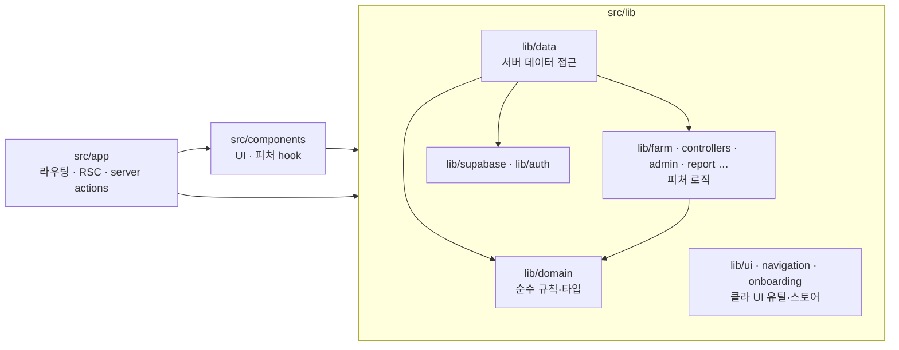

# 코드 컨벤션 — 폴더 책임 · 레이어 경계 · 네이밍

> 문서 허브: [`README.md`](./README.md) · 시스템: [`SYSTEM_NEXTJS.md`](./SYSTEM_NEXTJS.md) · 게이트: [`SCRIPTS.md`](./SCRIPTS.md)  
> **강제 수단:** `eslint.config.mjs`의 `layerBoundaries`(`no-restricted-imports`) · `tsc --noEmit` · `knip`  
> 적용: 2026-10 클린코드 P1. 이 문서와 코드가 다르면 **코드(`origin/main`)가 우선**이며 문서를 고친다.

---

## 1. 레이어와 의존 방향



| 방향 | 허용 | 금지 (ESLint error) |
|------|------|---------------------|
| `app` → `components`, `lib` | O | — |
| `components` → `lib` | O | `components` → `@/lib/supabase/*` |
| `lib` → `lib` | O | `lib/**` → `@/components/*` |
| `lib/domain` → | `lib/domain` 만 | `react` · `next*` · `server-only` · `@/lib/supabase/*` · `@/lib/data/*`(타입 포함) · `@/components` · `@/app` |

공유 타입은 `lib/domain/*-types.ts`에 둔다 (`iot-types.ts` · `barn-meta-types.ts`). `lib/data/iot.ts`·`barn-meta.ts`는 호환용으로 같은 이름을 재export하므로 기존 `@/lib/data/iot` 타입 import는 그대로 동작한다. **신규 코드는 `@/lib/domain/iot-types`를 직접 import**한다.

알려진 예외(추후 정리 대상, §6):
- `lib/**` → `@/app/**/actions` server action import 6건 (`lib/push`, `lib/navigation`, `lib/farm/fetch-farm-panel-enrich`, `lib/auth/native-oauth` 등). 규칙으로 막지 않았다.

---

## 2. 폴더 책임

| 폴더 | 책임 | 들어가는 것 | 들어가면 안 되는 것 |
|------|------|-------------|---------------------|
| `src/app` | 라우팅·RSC·Route Handler·**Server Action** | `page.tsx` · `layout.tsx` · `route.ts` · `actions.ts` | 재사용 UI · 도메인 규칙 |
| `src/components/<feature>` | UI 컴포넌트 + **그 피처 전용 React hook**(`use-*.ts`) | JSX · hook · 피처 컨텍스트 | Supabase 직접 호출 · 순수 규칙(→ `lib`) |
| `src/components/ui` | shadcn 프리미티브 (knip ignore) | 생성 코드 | 피처 로직 |
| `src/lib/domain` | **순수** 도메인 타입·규칙·포맷. 서버/클라/Edge 어디서든 import 가능 | 키 정규화 · 상태 판정 · 집계 · 타입 · 상수 | React · Next · Supabase · `server-only` · `process.env` 외 I/O |
| `src/lib/data` | **서버 전용** 데이터 접근 | `import "server-only"` · `createClient`(server) · `cache()` 로더 · `*-shell-data` | 클라이언트 전용 코드 · UI |
| `src/lib/data/browser` | **브라우저** Supabase 조회 (anon + RLS) | `"use client"` · `fetch*Browser()` | server-only · hook (hook은 components) |
| `src/lib/<feature>` (`farm`·`controllers`·`admin`·`report`·`geo`·`onboarding`) | 피처 로직. React 없음(`farm`·`controllers`·`onboarding`은 현재 React-free) | 계산 · URL 계약 · 캐시 · wire 인코딩 | 컴포넌트 import · hook |
| `src/lib/ui` · `lib/navigation` | 클라 UI 유틸·디자인 토큰·전역 스토어·범용 hook | `motion-classes` · `dashboard-page-ui` · `use-mobile-layout` | 피처 지식 · Supabase |
| `src/lib/supabase` · `lib/auth` | 클라이언트 팩토리(server/browser/admin/rls) · 세션·권한 | — | 도메인 로직 |
| `supabase/functions` | Deno Edge (decode-batch · push-dispatch) | Edge 전용 | 앱 코드 import (tsconfig exclude) |

### 판단 기준 (새 파일을 어디에 두나)

1. Supabase/`next/*`/`server-only`를 import 하나? → 서버면 `lib/data`, 브라우저면 `lib/data/browser`.
2. React hook인가? → 피처 전용이면 `components/<feature>/use-*.ts`, 범용이면 `lib/ui`.
3. 위 둘 다 아니고 특정 피처 어휘(차트·명령·투어)인가? → `lib/<feature>`.
4. 모든 피처가 공유하는 어휘(농장 키·채널·상태 판정·알람 규칙)인가? → `lib/domain`.

---

## 3. 네이밍

| 종류 | 규칙 | 예 |
|------|------|----|
| 파일 | kebab-case | `farm-trend-history.ts` |
| React hook 파일 | `use-*.ts(x)` | `components/farm/use-barn-graphs.tsx` |
| 서버 fetch | 동사형 `get*` / `fetch*` / `list*` | `lib/data/commands.ts: listThermoCommands` |
| 브라우저 fetch | `fetch*Browser` | `lib/data/browser/command-presets.ts` |
| 서버 액션 | `*Action` | `saveCommandDefaultsAction` |
| 테스트 | 대상 옆 `*.test.ts` (`node:assert`, `npm test`) | `lib/domain/live-status.test.ts` |
| 동명 서버/순수 쌍 | 허용하되 서버는 `lib/data`, 순수는 `lib/<feature>` | `data/command-presets.ts` ↔ `farm/command-presets.ts` |

- barrel(`index.ts`) 쓰지 않는다. import는 항상 파일 직접 경로 (`@/lib/domain/farm-key`).
- import 경로는 `@/` 절대 경로. 같은 폴더 안에서만 `./` 허용.

---

## 4. 파일 크기 · 컴포넌트 분해 가이드

| 지표 | 가이드 | 현황(2026-10) |
|------|--------|---------------|
| 파일 LOC | ≤ 400 권장, 800 초과 금지(신규) | 500+ 컴포넌트 22 · lib 14 — P2 분해 대상 |
| 컴포넌트 hook 수 | ≤ 8. 넘으면 `use-*.ts`로 추출 | `trend-chart.tsx` 19 |
| export 수/파일 | ≤ 20 | `unified-barn-trend-series.ts` 62 |

분해 순서: 순수 함수 추출(→ `lib`) → hook 추출(→ `use-*.ts`) → 하위 컴포넌트 분리. 각 단계 `npm run check`.

---

## 5. 게이트 (push 전)

```bash
cd web
npm run check          # lint → typecheck → test → knip
npm run verify:design  # 모션·밀도·어포던스 토큰
npm run build          # 더미 Supabase env로도 통과해야 함
```

GitHub Actions(`.github/workflows/web-verify.yml`)와 GitLab CI가 동일 단계를 실행한다 ([`GITLAB_CI.md`](./GITLAB_CI.md)).

---

## 6. 후속(P2) 과제

| 항목 | 이유 | 완료 조건 |
|------|------|-----------|
| ~~`lib/data/iot.ts` 타입 → `lib/domain/iot-types.ts`~~ | 완료 (P2-0, 2026-10-11). `iot.ts` 446→214줄 | — |
| `lib/**` → `@/app/**/actions` 6건 | lib가 라우팅 레이어를 모르게 | action 호출을 호출측(components/app)에서 주입하거나 `lib/actions`로 이동 |
| 500 LOC+ 핫스팟 분해 | §4 | `trend-chart.tsx` · `unified-barn-trend-*` · `farm-page-content.tsx` |
| vitest 도입 | coverage · watch | 패키지 추가 승인 필요 |

---

## 변경 이력

| 날짜 | 내용 |
|------|------|
| 2026-10-11 | 초안 — P1: `lib/domain` 분리(38+15 test) · 피처 hook `components/`로 · `lib/data/browser` · ESLint 경계 규칙 |
| 2026-10-11 | P2-0: `iot-types.ts` · `barn-meta-types.ts` 분리, domain → data 타입 import 금지로 전환 |
