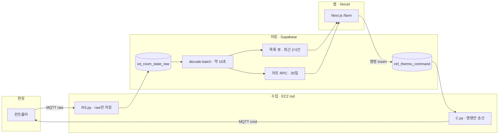

# 인수인계 — 시스템 한 장

운영 DB `fkkrjljeqxpbmazfnync`. 화면 `https://smart.autofankorea.com`. 코드가 이 그림보다 우선이다. 상세는 아래 정본으로 들어간다.

---

## 1. 배포 경계

칸은 기계 단위다. 상자 하나가 그 기계의 일이다.

Next.js는 wire를 해석하지 않고 MQTT를 직접 쏘지 않는다. 해석은 Edge `decode-batch`이다.

| 칸 | 저장소 | 하는 일 |
|----|--------|---------|
| 수집 | [`rsd`](https://github.com/SIJackLee/rsd) | MQTT를 받아 raw를 넣고, 명령 행을 현장으로 보낸다 |
| 저장 | Supabase `fkkrjljeqxpbmazfnync` | raw를 해석하고, 목록·차트·명령 행을 보관한다 |
| 앱 | `dashboard/web` → Vercel | 뷰를 읽고 명령을 넣는다. 운영자가 보는 화면이다 |

---

## 2. 숫자로 읽는 같은 그림

위 화살표와 같은 순서다.

1. 컨트롤러가 MQTT로 측정값을 보낸다.
2. RS.py가 `iot_room_state_raw`에 raw만 넣는다.
3. `decode-batch`가 약 10초마다 해석한다.
4. 목록·카드는 최근 2시간 스칼라 뷰만 읽는다. 차트는 30일 RPC를 읽는다.
5. 운영자가 설정을 보내면 `ctrl_thermo_command` 행이 생긴다.
6. C.py가 `0x0D` 또는 `0x0E` 패킷을 내린다.
7. 장비 ACK가 raw로 다시 올라온다.
8. 화면이 접수·전송·확인을 갱신한다.

명령 행은 적용·취소 후 90일이다. `sent`가 24시간 지나면 취소로 정리된다. 기준은 [`SYSTEM_DB.md`](./SYSTEM_DB.md) §2.8이다.

---

## 3. 막히면 여는 문서

증상 하나당 파일 하나다.

| 증상 | 정본 |
|------|------|
| 수집이 비거나 EC2·MQTT가 의심될 때 | [`SYSTEM_INSTANCE.md`](./SYSTEM_INSTANCE.md) |
| 목록 값·HOT 뷰·명령 행 보관 | [`SYSTEM_DB.md`](./SYSTEM_DB.md) |
| 배포, CI, 장애 순서 | [`OPS.md`](./OPS.md) |
| `/farm` URL, 환경 상태 | [`farm-hub-url.md`](./farm-hub-url.md) |
| 화면을 어떻게 쓰는지 | [`user-manual/README.md`](./user-manual/README.md) |

패킷 바이트, 테이블 전체, UI 토큰은 이 장에 두지 않는다. 업링크는 [`protocol/데이터폼.md`](./protocol/데이터폼.md), 다운링크는 [`COMMANDS.md`](./COMMANDS.md), 앱 내부 계층은 [`SYSTEM_APP.md`](./SYSTEM_APP.md)이다.
