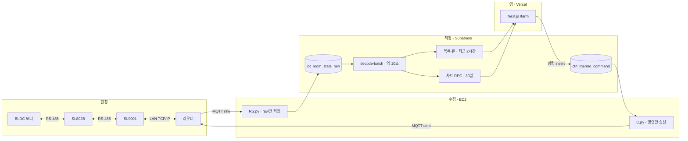

# 인수인계 — 시스템 한 장

운영 DB `fkkrjljeqxpbmazfnync`. 화면 `https://smart.autofankorea.com`. 코드가 이 그림보다 우선이다. 상세는 아래 정본으로 들어간다.

---

## 1. 배포 경계

칸은 기계 단위다. 상자 하나가 그 기계의 일이다.

현장 선은 양방향이다. 측정은 모터에서 라우터로, 명령은 라우터에서 모터로 같은 선을 탄다.

| 장비 | 문서의 이름 | 선 |
|------|-------------|-----|
| BLDC 모터 | 환기 구동 | 입출력 RS-485 |
| SL802B | 컨트롤러 | 입출력 RS-485. 모터와 SL9001 사이 |
| SL9001 | 통신모듈 | 컨트롤러 쪽 RS-485, 라우터 쪽 LAN TCP/IP |
| 라우터 | 현장 LAN의 출구 | SL9001와는 LAN TCP/IP. EC2가 받는 입구는 MQTT |

SL9001이 SL802B를 RS-485로 순차로 읽고, 한 대 읽을 때마다 MQTT `…/raw` 1건이 된다. 모듈당 최대 48대. 화면과 DB의 컨트롤러 키는 SL802B이다.

Next.js는 wire를 해석하지 않고 MQTT를 직접 쏘지 않는다. 해석은 Edge `decode-batch`이다.

| 칸 | 저장소 | 하는 일 |
|----|--------|---------|
| 수집 | Git 없음. SSH·에이전트로 EC2의 `rsd-rs`·`rsd-c`를 관리 | MQTT를 받아 raw를 넣고, 명령 행을 현장으로 보낸다 |
| 저장 | Supabase `fkkrjljeqxpbmazfnync` | raw를 해석하고, 목록·차트·명령 행을 보관한다 |
| 앱 | `dashboard/web` → Vercel | 뷰를 읽고 명령을 넣는다. 운영자가 보는 화면이다 |

수집 인스턴스 안의 코드는 Git으로 관리하지 않는다. 변경은 SSH 접속과 에이전트로 한다. 프로세스는 `rsd-rs`, `rsd-c`이다.

---

## 2. 숫자로 읽는 같은 그림

위 화살표와 같은 순서다.

1. BLDC 모터와 SL802B가 RS-485로 상태를 주고받는다.
2. SL802B와 SL9001이 RS-485로 그 값을 주고받는다.
3. SL9001이 라우터와 LAN TCP/IP로 붙는다.
4. 라우터 너머 MQTT `…/raw`가 RS.py에 들어가 `iot_room_state_raw`에 raw만 쌓인다.
5. `decode-batch`가 약 10초마다 해석한다.
6. 목록·카드는 최근 2시간 스칼라 뷰만 읽는다. 차트는 30일 RPC를 읽는다.
7. 운영자가 설정을 보내면 `ctrl_thermo_command` 행이 생기고, C.py가 `0x0D` 또는 `0x0E`를 MQTT `…/cmd`로 내린다.
8. 명령은 라우터 → SL9001(LAN TCP/IP) → SL802B(RS-485) → BLDC 모터(RS-485)로 돌아간다. ACK는 다시 raw로 올라오고, 화면이 접수·전송·확인을 갱신한다.

명령 행은 적용·취소 후 90일이다. `sent`가 24시간 지나면 취소로 정리된다. 기준은 [`SYSTEM_DB.md`](./SYSTEM_DB.md) §2.8이다.

---

## 3. 막히면 여는 문서

증상 하나당 파일 하나다.

| 증상 | 정본 |
|------|------|
| 수집이 비거나 EC2·MQTT가 의심될 때 | [`SYSTEM_INSTANCE.md`](./SYSTEM_INSTANCE.md) |
| 목록 값·HOT 뷰·명령 행 보관 | [`SYSTEM_DB.md`](./SYSTEM_DB.md) |
| 배포, CI, 장애 순서 | [`OPS.md`](./OPS.md) |
| `/farm` URL, 환경 상태 | [`farm-hub-url.md`](./farm-hub-url.md) |
| 화면을 어떻게 쓰는지 | [`user-manual/README.md`](./user-manual/README.md) |

패킷 바이트, 테이블 전체, UI 토큰은 이 장에 두지 않는다. 업링크는 [`protocol/데이터폼.md`](./protocol/데이터폼.md), 다운링크는 [`COMMANDS.md`](./COMMANDS.md), 앱 내부 계층은 [`SYSTEM_APP.md`](./SYSTEM_APP.md)이다.
