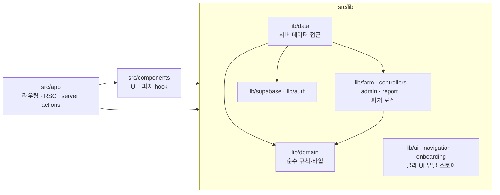
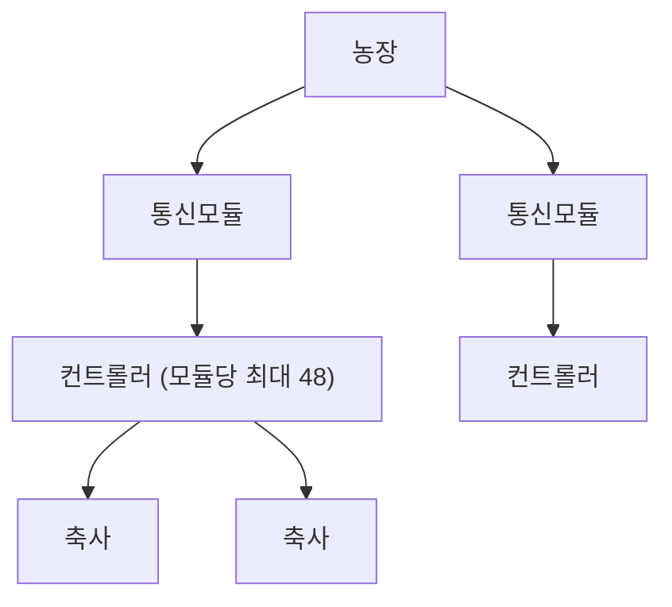

# 서버·클라이언트

첫 부는 코드 계약이다. 이어서 RS-DB-C 총론, Next.js 경로, 작업 맥락이다. 인스턴스·DB·장애의 상세는 [`SYSTEM_INSTANCE.md`](./SYSTEM_INSTANCE.md), [`SYSTEM_DB.md`](./SYSTEM_DB.md), [`OPS.md`](./OPS.md).


---

## 코드 계약

## 코드 컨벤션 — 폴더 책임 · 레이어 경계 · 네이밍

> 문서 허브: [`README.md`](./README.md) · 시스템: [`SYSTEM_APP.md`](#nextjs) · 게이트: [`OPS.md`](./OPS.md#스크립트)  
> **강제 수단:** `eslint.config.mjs`의 `layerBoundaries`(`no-restricted-imports`) · `tsc --noEmit` · `knip`  
> 적용: 2026-10 클린코드 P1. 이 문서와 코드가 다르면 **코드(`origin/main`)가 우선**이며 문서를 고친다.

---

### 1. 레이어와 의존 방향



| 방향 | 허용 | 금지 (ESLint error) |
|------|------|---------------------|
| `app` → `components`, `lib` | O | — |
| `components` → `lib` | O | `components` → `@/lib/supabase/*` |
| `lib` → `lib` | O | `lib/**` → `@/components/*` · `@/app/*` |
| `lib/domain` → | `lib/domain` 만 | `react` · `next*` · `server-only` · `@/lib/supabase/*` · `@/lib/data/*`(타입 포함) · `@/components` · `@/app` |

공유 타입은 `lib/domain/*-types.ts`에 둔다 (`iot-types.ts` · `barn-meta-types.ts`). `lib/data/iot.ts`·`barn-meta.ts`는 호환용으로 같은 이름을 재export하므로 기존 `@/lib/data/iot` 타입 import는 그대로 동작한다. **신규 코드는 `@/lib/domain/iot-types`를 직접 import**한다.

서버 액션을 부르는 React provider는 `components`에 둔다. 농장 라이브 리프레시는 `components/farm/farm-live-refresh.tsx`이고, `lib/navigation/farm-live-refresh-bridge.ts`는 핸들러 등록만 남긴다. lib가 액션이 필요하면 호출측이 함수를 넘긴다 (`fetchFarmPanelEnrichShared`, `registerPushDeviceIfNative`).

---

### 2. 폴더 책임

| 폴더 | 책임 | 들어가는 것 | 들어가면 안 되는 것 |
|------|------|-------------|---------------------|
| `src/app` | 라우팅·RSC·Route Handler·**Server Action** | `page.tsx` · `layout.tsx` · `route.ts` · `actions.ts` | 재사용 UI · 도메인 규칙 |
| `src/components/<feature>` | UI 컴포넌트 + **그 피처 전용 React hook**(`use-*.ts`) | JSX · hook · 피처 컨텍스트 | Supabase 직접 호출 · 순수 규칙(→ `lib`) |
| `src/components/ui` | shadcn 프리미티브 (knip ignore) | 생성 코드 | 피처 로직 |
| `src/lib/domain` | **순수** 도메인 타입·규칙·포맷. 서버/클라/Edge 어디서든 import 가능 | 키 정규화 · 상태 판정 · 집계 · 타입 · 상수 | React · Next · Supabase · `server-only` · `process.env` 외 I/O |
| `src/lib/data` | **서버 전용** 데이터 접근 | `import "server-only"` · `createClient`(server) · `cache()` 로더 · `*-shell-data` | 클라이언트 전용 코드 · UI |
| `src/lib/data/browser` | **브라우저** Supabase 조회 (anon + RLS) | `"use client"` · `fetch*Browser()` | server-only · hook (hook은 components) |
| `src/lib/<feature>` (`farm`·`controllers`·`admin`·`report`·`geo`·`onboarding`) | 피처 로직. React 없음(`farm`·`controllers`·`onboarding`은 현재 React-free) | 계산 · URL 계약 · 캐시 · wire 인코딩 | 컴포넌트 import · hook |
| `src/lib/ui` · `lib/navigation` | 클라 UI 유틸·디자인 토큰·전역 스토어·범용 hook | `motion-classes` · `dashboard-page-ui` · `use-mobile-layout` | 피처 지식 · Supabase |
| `src/lib/supabase` · `lib/auth` | 클라이언트 팩토리(server/browser/admin/rls) · 세션·권한 | — | 도메인 로직 |
| `supabase/functions` | Deno Edge (decode-batch · push-dispatch) | Edge 전용 | 앱 코드 import (tsconfig exclude) |

#### 판단 기준 (새 파일을 어디에 두나)

1. Supabase/`next/*`/`server-only`를 import 하나? → 서버면 `lib/data`, 브라우저면 `lib/data/browser`.
2. React hook인가? → 피처 전용이면 `components/<feature>/use-*.ts`, 범용이면 `lib/ui`.
3. 위 둘 다 아니고 특정 피처 어휘(차트·명령·투어)인가? → `lib/<feature>`.
4. 모든 피처가 공유하는 어휘(농장 키·채널·상태 판정·알람 규칙)인가? → `lib/domain`.

---

### 3. 네이밍

| 종류 | 규칙 | 예 |
|------|------|----|
| 파일 | kebab-case | `farm-trend-history.ts` |
| React hook 파일 | `use-*.ts(x)` | `components/farm/use-barn-graphs.tsx` |
| 서버 fetch | 동사형 `get*` / `fetch*` / `list*` | `lib/data/commands.ts: listThermoCommands` |
| 브라우저 fetch | `fetch*Browser` | `lib/data/browser/command-presets.ts` |
| 서버 액션 | `*Action` | `saveCommandDefaultsAction` |
| 테스트 | 대상 옆 `*.test.ts` (`node:assert` 또는 vitest `describe`/`it`, `npm test`) | `lib/domain/live-status.test.ts` |
| 동명 서버/순수 쌍 | 허용하되 서버는 `lib/data`, 순수는 `lib/<feature>` | `data/command-presets.ts` ↔ `farm/command-presets.ts` |

- barrel(`index.ts`) 쓰지 않는다. import는 항상 파일 직접 경로 (`@/lib/domain/farm-key`).
- import 경로는 `@/` 절대 경로. 같은 폴더 안에서만 `./` 허용.
- `node:assert`만 있는 파일은 단언이 모듈 평가에서 실행된다. 파일 끝의 `test("module asserts")`가 vitest 스위트로 등록한다. `describe`/`it`는 `vitest`에서 가져온다.

---

### 4. 파일 크기 · 컴포넌트 분해 가이드

| 지표 | 가이드 | 현황(2026-10) |
|------|--------|---------------|
| 파일 LOC | ≤ 400 권장, 800 초과 금지(신규) | 500+ 컴포넌트 22 · lib 14 — P2 분해 대상 |
| 컴포넌트 hook 수 | ≤ 8. 넘으면 `use-*.ts`로 추출 | `trend-chart.tsx` 33 → 18 호출(ref 27 → 5, effect 6 → 0) — P2-1d 후 |
| export 수/파일 | ≤ 20 | `unified-barn-trend-series.ts`는 재export 배럴. 구현은 `unified-trend-*` (P2-2) |

분해 순서: 순수 함수 추출(→ `lib`) → hook 추출(→ `use-*.ts`) → 하위 컴포넌트 분리. 각 단계 `npm run check`.  
차트(`TrendChart`)는 추가로 `npm run snapshot:chart-markup -- --baseline <분해 전 캡처>`로 렌더 markup diff 0 을 확인한다 ([`OPS.md`](./OPS.md#스크립트) § C).  
`TrendChart` 순수 계산은 `lib/farm/trend-chart-geometry.ts`(패딩·도메인·라벨 배치)와 `lib/farm/trend-chart-layout.ts`(좌표 매핑·눈금·밴드/이벤트 배치)에 두고, 컴포넌트는 클로저로 감싸 호출만 한다. 스냅샷 fixture는 line 모드만 렌더하므로 bar 모드·이벤트 레인·명령 밴드 경로는 `trend-chart-layout.test.ts`가 담당한다.  
`TrendChart`의 상태·effect는 `components/trends/use-trend-*.ts`에 역할별로 둔다: `plot-size`(ResizeObserver), `crosshair`(십자선 DOM 조작), `pin-window-remap`(줌 시 고정 카드 재배치), `lookback-gesture`(휠·핀치), `scale-edge-edit`(스케일 엣지 드래그/숫자 입력), `edge-band-labels`(알람·기준선 끝단 라벨), `pinned-tips`, `scope-gesture`, `hover`(호버 인덱스·카드 배치). hook은 옵션 객체 하나를 받고, JSX에 부착할 ref와 핸들러를 그대로 반환한다(동작 변경 없는 1:1 이동 원칙). `clearHover`만 십자선 숨김 때문에 `TrendChart`에 남긴다.  
화면 조각은 `trend-chart-legend.tsx`, `trend-chart-crosshair-chip.tsx`, `trend-y-label-chip.tsx`, `trend-chart-y-axis.tsx`, `trend-chart-edge-labels.tsx`, `trend-chart-pinned-cards.tsx`, `trend-chart-hover-card.tsx`에 둔다. 플롯 SVG(프레임·데이터·십자선·스코프 드래프트)는 `trend-chart-plot-svg.tsx`, X축 눈금 레일은 `trend-chart-x-axis.tsx`에 둔다. 데이터 지점 히트는 `trend-chart-hit.ts`, 호버 카드에 올릴 값은 `trend-chart-hover-live.ts`에 둔다. 결측 구간과 세그먼트 빌더는 `trend-chart-geometry.ts`에 둔다. 플롯 크기·호버·좌표 재료는 `use-trend-chart-model.ts`, 축 눈금·기준선 presence는 `use-trend-chart-decor.ts`, 플롯 루트 안쪽 화면은 `trend-chart-plot-body.tsx`에 둔다. 클라이언트 좌표 변환은 `trend-chart.tsx`에 남기고, 포인터 핸들러 본문은 `trend-chart-plot-pointer.ts`가 만들어 플롯 루트에 붙인다.  
통합 추세 순수 로직은 `unified-trend-split-y.ts`(값↔밴드), `unified-trend-split-y-overflow.ts`(이탈 스케일), `unified-trend-split-y-ticks.ts`(밴드 눈금), `unified-barn-trend-layout.ts`(밴드 기하), `unified-trend-y-bands.ts`(레이어·Y밴드 마스킹), `unified-trend-raw.ts`(집계·EMA), `unified-trend-build.ts`(시리즈 조립), `unified-trend-layers.ts`(레이어 선택·트림), `unified-trend-colors.ts`(색·이름)에 둔다. `unified-barn-trend-series.ts`는 임계 코리도와 공개 이름 재export만 남기고, 기존 `@/lib/farm/unified-barn-trend-series` import는 유지한다. 이 모듈은 차트를 그리지 않으므로 markup 스냅샷 대상이 아니다.  
`UnifiedBarnTrendPanel`의 경보 눈금은 `unified-barn-trend-scale-edges.ts`, 제목 마크는 `unified-barn-trend-scope-marks.tsx`, 헤더는 `unified-barn-trend-panel-header.tsx`에 둔다. 표시 창 집계는 `unified-barn-trend-window.ts`, 명령 설정 오버레이는 `unified-barn-trend-command-overlay.ts`, X 스코프 인덱스·15분 구간은 `unified-barn-trend-x-scope.ts`에 둔다. 스코프 시계열 재집계는 `unified-barn-trend-scoped.ts`, 안내 제스처의 플롯 비율은 `unified-barn-trend-guided-scope.ts`, TrendChart에 넘기는 값 조립은 `unified-barn-trend-chart.tsx`에 둔다. 레이어·브러시 상태는 `use-unified-barn-trend-chrome.ts`, 창 집계 메모는 `use-unified-barn-trend-series.ts`, 스코프 커밋은 `use-unified-barn-trend-scope-actions.ts`, 재집계·눈금·툴바는 `use-unified-barn-trend-view.tsx`, 화면은 `unified-barn-trend-panel-frame.tsx`에 둔다. 줌 스택 setState·줌 effect·humanize 캐시는 패널에 남긴다.  
농장 허브의 데스크톱 현장 스플릿은 `farm-field-split.tsx`, 차트 탭 슬롯은 `farm-chart-slot.tsx`에 둔다. 보기 탭은 `farm-view-toggle.tsx`에 둔다. 페이지의 목록 enrich·보기 상태·차트 URL은 `use-farm-page-content-state.ts`와 `use-farm-page-chart-actions.ts`에 둔다.

---

### 5. 게이트 (push 전)

```bash
cd web
npm run check          # lint → typecheck → test → knip
npm test               # vitest run (CI와 동일)
npm run test:watch     # 파일 저장 시 관련 테스트만
npm run test:coverage  # v8 줄 커버리지. src/** . 임계값은 두지 않는다
npm run verify:design  # 모션·밀도·어포던스 토큰
npm run build          # 더미 Supabase env로도 통과해야 함
```

GitHub Actions(`.github/workflows/web-verify.yml`)와 GitLab CI가 동일 단계를 실행한다 ([`OPS.md`](./OPS.md#ci)).

---

### 6. 후속(P2) 과제

| 항목 | 이유 | 완료 조건 |
|------|------|-----------|
| ~~`lib/data/iot.ts` 타입 → `lib/domain/iot-types.ts`~~ | 완료 (P2-0, 2026-10-11). `iot.ts` 446→214줄 | — |
| ~~`lib/**` → `@/app/**`~~ | 완료 (P2-14). 런타임 3곳 주입 · `OAuthProvider`는 `lib/auth` · provider는 `components/farm`. ESLint가 `lib` → `@/app`를 막는다 | — |
| ~~`unified-barn-trend-series.ts` 구현 분리~~ | 완료 (P2-2). 배럴 2387→310줄. 구현은 `unified-trend-split-y` · `raw` · `build` · `layers` · `colors` | — |
| ~~500 LOC+ 핫스팟 분해~~ | 완료 (P2-16·17·18). `farm-page-content.tsx` 385 · `unified-barn-trend-panel.tsx` 406 · `trend-chart.tsx` 338 | — |
| ~~vitest 도입~~ | 완료 (P2-15). `npm test`는 `vitest run`. `test:watch` · `test:coverage` | — |

---

### 변경 이력

| 날짜 | 내용 |
|------|------|
| 2026-10-11 | 초안 — P1: `lib/domain` 분리(38+15 test) · 피처 hook `components/`로 · `lib/data/browser` · ESLint 경계 규칙 |
| 2026-10-11 | P2-0: `iot-types.ts` · `barn-meta-types.ts` 분리, domain → data 타입 import 금지로 전환 |
| 2026-10-12 | P2-2: `unified-barn-trend-series.ts` 구현을 split-y·raw·build·layers·colors로 분리. 배럴 재export로 import 경로 유지 |
| 2026-10-12 | P2-3: 통합 추세 패널에서 경보 눈금·헤더를 분리. `unified-barn-trend-panel.tsx` 2148→1763줄 |
| 2026-10-12 | P2-4: 농장 보기 탭을 `farm-view-toggle.tsx`로 분리 |
| 2026-10-12 | P2-5: 통합 추세 패널의 창 집계·명령 오버레이·X 스코프 계산을 분리. `unified-barn-trend-panel.tsx` 1763→1566줄 |
| 2026-10-12 | P2-6: 농장 현장 스플릿과 차트 슬롯을 `farm-field-split.tsx` · `farm-chart-slot.tsx`로 분리. `farm-page-content.tsx` 798→749줄 |
| 2026-10-12 | P2-7: 추이 차트 데이터 지점 히트를 `trend-chart-hit.ts`로 분리. `trend-chart.tsx` 2022→1810줄. 포인터 핸들러는 플롯 루트에 유지 |
| 2026-10-12 | P2-8: `unified-trend-split-y.ts`에서 이탈 스케일과 밴드 눈금을 분리. 842→688줄 |
| 2026-10-12 | P2-9: 추이 차트 플롯 SVG와 X축 눈금 레일을 `trend-chart-plot-svg.tsx` · `trend-chart-x-axis.tsx`로 분리. `trend-chart.tsx` 1810→1574줄. 포인터 핸들러는 플롯 루트에 유지 |
| 2026-10-12 | P2-10: 통합 추세 패널의 스코프 재집계와 안내 제스처 비율을 분리. `unified-barn-trend-panel.tsx` 1566→1376줄. 줌 setState는 패널에 유지 |
| 2026-10-12 | P2-11: `unified-barn-trend-layout.ts`에서 레이어·Y밴드 마스킹을 `unified-trend-y-bands.ts`로 분리. 872→435줄. 기존 import는 레이아웃 재export로 유지 |
| 2026-10-12 | P2-12: 호버 카드 값과 결측·세그먼트 빌더를 분리. `trend-chart.tsx` 1574→1528줄. 포인터 핸들러는 플롯 루트에 유지 |
| 2026-10-12 | P2-13: 통합 추세 패널의 TrendChart 값 조립을 `unified-barn-trend-chart.tsx`로 분리. `unified-barn-trend-panel.tsx` 1376→1276줄. 줌 setState는 패널에 유지 |
| 2026-10-12 | P2-14: `lib`가 서버 액션을 직접 부르지 않게 한다. 패널 enrich·푸시 등록은 호출측이 액션을 주입하고, 라이브 리프레시 provider는 `components/farm/farm-live-refresh.tsx`로 옮겼다. `OAuthProvider`는 `lib/auth/oauth-provider.ts`로 옮기고 액션이 재export한다 |
| 2026-10-12 | P2-15: 유닛 러너를 vitest로 교체. `describe`/`it` 20파일은 vitest import. 나머지 `node:assert` 파일은 그대로 실행. `test:watch` · `test:coverage` |
| 2026-10-12 | P2-16: 농장 페이지의 목록 enrich·보기 상태·차트 URL을 hook으로 분리. `farm-page-content.tsx` 753→385줄 |
| 2026-10-12 | P2-17: 통합 추세 패널의 집계·화면을 hook과 프레임으로 분리. `unified-barn-trend-panel.tsx` 1276→406줄. 줌 effect·humanize 캐시·스택 setState는 패널에 유지 |
| 2026-10-12 | P2-18: 추이 차트의 모델·장식·플롯 본문·포인터 본문을 분리. `trend-chart.tsx` 1528→338줄. 좌표 변환과 포인터 부착은 플롯 루트에 유지 |


---

## 시스템 총론

## 시스템 문서 — Instance · DB · Next.js

> **범위:** 스마트 축사 IoT 대시보드(RS-DB-C)의 **인스턴스(EC2) · DB(Supabase) · Next.js(Back/Front)**  
> **작성 원칙:** 각 절은 **설계 이유**(왜) → **경로**(어디) → **운영**(장애·TODO) 순.  
> UI/UX·디자인 토큰은 별도([`UI.md`](./UI.md#면) 등).  
> **정본 우선순위:** `git status` / `origin/main` > 이 문서 > [`QA_RECORD.md`](./QA_RECORD.md)

---

### 목차

1. [전체 시스템](#1-전체-시스템)
2. [개별 시스템](#2-개별-시스템)
3. [운영 및 리스크 대응](#3-운영-및-리스크-대응)
4. [참고](#4-참고)

---

### 1. 전체 시스템

#### 1.1 한 줄 요약

현장 장비 → **EC2(RS/C/MQTT)** 가 Supabase **raw** 적재 → **Edge decode-batch** + **Next.js(Vercel)** 가 디코드·LIVE UI·명령 insert → 운영자 브라우저.

#### 1.2 계층 구조 (RS-DB-C)

| 계층 | 담당 | 산출물 |
|------|------|--------|
| **R** (Receive) | EC2 `RS.py` | `iot_room_state_raw` (MQTT payload) |
| **S** (Store) | Supabase Postgres | raw · decoded · last_value · 명령·프로필 |
| **C** (Consume) | Vercel Next.js + Edge Functions | LIVE 카드 · 차트 · PDF · 관리자 헬스 |

- **배포 분리:** EC2는 SSH·에이전트로 관리(`rsd-rs` · `rsd-c`, Git 없음) · 대시보드 = `dashboard/web` → Vercel ([`OPS.md`](./OPS.md#배포))
- **decode 소유:** 과거 D.py INSERT → **현행은 Edge `decode-batch` + 앱 read path** ([`OPS.md`](./OPS.md#배포) § RS-DB-C)

#### 1.3 데이터 흐름 (정상 경로)

```mermaid
flowchart LR
  DEV[컨트롤러/통신모듈] --> MQTT[MQTT QoS1]
  MQTT --> RS[EC2 RS.py]
  RS --> RAW[(iot_room_state_raw)]
  RAW --> DEC[Edge decode-batch]
  DEC --> DCD[(iot_room_state_decoded)]
  DEC --> LV[(iot_decoded_last_value)]
  DCD --> V1[v_iot_dashboard_list]
  DCD --> V2[v_iot_decoded_latest]
  V1 --> APP[Next.js /farm]
  V2 --> APP
  APP --> CMD[ctrl_thermo_command INSERT]
  CMD --> CPY[EC2 C.py downlink]
  CPY --> DEV
  EC2H[rsd-healthcheck] --> IHC[(instance_health_current)]
  IHC --> ADMIN[/admin/ops 헬스]
```

#### 1.4 현장 도메인 (읽기 시 공통)

| 계층 | 설명 | DB 키 예 |
|------|------|----------|
| 농장 | 다농장 · UI 표시명 | `lsind_regist_no` + `item_code` → `FARM02/P00` |
| 통신모듈 | RS-485 마스터 · 컨트롤러 최대 48 | `module_uid` |
| 컨트롤러 | 온·습·팬 측정 단위 | `controller_key` (예 `SP07:01:01`) |
| 축사 | 지도 카드 1장 | `stall_ty_code` + `stall_no` |

상세: [`SYSTEM_APP.md`](#작업-맥락) §5

#### 1.5 시간축 정책 (혼동 방지)

| 축 | 필드 | 용도 |
|----|------|------|
| **수신** | `received_at` | LIVE 카드 신선도 · 2h hot view |
| **측정** | `mesure_at` / `mesure_dt` | 차트 · PDF · 히트맵 버킷 |
| **clock 보정** | `iot_decode_config.clock_kst_farm_keys` | KST-stuffed firmware → decode 시 −9h ([`SYSTEM_APP.md`](#작업-맥락)) |

수신은 최신인데 측정이 정체면 **주의(caution)** — 버퍼 replay·장비 시계 정지와 구분 ([`live-status.ts`](../src/lib/domain/live-status.ts)).

#### 1.6 권한·보안 경계

- **브라우저:** anon key + RLS (`user_can_read_farm`, `is_admin`)
- **서버(사용자 컨텍스트):** `@supabase/ssr` cookie session
- **서버(관리 전용):** `service_role` — `server-only`, 관리자 헬스·일부 admin API만
- **명령:** 대시보드는 DB insert·적용 큐·이력까지 · MQTT downlink는 EC2 **C.py**
- **외부 연계 (Health DAG):** Ekape/FTP 등 — **미구현** (대기/비활성 표시)

#### 1.7 설계 원칙 (횡단 — 문서 정본)

> **시스템 문서는 경로 나열이 아니라 「결정 → 이유 → 기각안」이 핵심이다.**  
> 아래 표는 §2.1–2.4 공통 전제. 각 절은 동일 형식으로 상세화한다.

| 결정 | 설계 이유 | 하지 않은 것 | 근거 |
|------|-----------|--------------|------|
| **RS-DB-C 3계층** | 수집(EC2)·저장(DB)·소비(Vercel)의 배포 주기·장애 반경·스케일 요구가 다름 | 올인원 EC2(구 D.py decode+UI) · 브라우저 직접 MQTT | [`OPS.md`](./OPS.md#배포) · [`데이터폼.md`](./protocol/데이터폼.md) §8 |
| **해석(decode)을 DB Edge** | raw 옆 **~10초 cron** · batch cursor · sparse/clock이 `iot_decoded_last_value`·`iot_decode_config`와 같은 트랜잭션·스키마 필요 | RS에서 wire decode(Phase3+ 폐기) · Next API batch decode · 농장별 decode 서버 | [`IOT_RETENTION_OPTIONS.md`](./IOT_RETENTION_OPTIONS.md) · `supabase/functions/decode-batch/` |
| **명령·uplink 동일 DB** | INSERT 감사·RLS·pending queue · uplink thermo와 command payload **ACK diff** · C.py **단일 downlink 소비자** | 대시보드→MQTT 직접 publish · 명령 전용 DB/Redis 분리 | [`COMMANDS.md`](./COMMANDS.md#부록--phase-a-관측) · [`데이터폼.md`](./protocol/데이터폼.md) §4.3 |
| **운영 단일 Supabase 프로젝트** (`fkkrjljeqxpbmazfnync`) | Auth·RLS·JOIN view·Edge cron·명령 ACK를 **한 Postgres**에서 | multi-DB COLD(E) · 농장별 Supabase · **폐기된 `iot-cloud`(`ompufme…`) 재사용** | [`SYSTEM_DB.md`](./SYSTEM_DB.md) · [`IOT_RETENTION_OPTIONS.md`](./IOT_RETENTION_OPTIONS.md) |
| **LIVE vs 추이 시간축 분리** | `received_at`=신선도(2h hot) · `mesure_at`=차트/PDF. **버퍼 replay**와 live stream 구분 | REPLAY 전용 UI/DB 모드 · received만 LIVE 표시 | [`SYSTEM_APP.md`](#작업-맥락) · [`live-status.ts`](../src/lib/domain/live-status.ts) |

**Instance를 농장별로 쪼개지 않은 이유 (요약):** MQTT 브릿지·키·systemd 운영을 **1벌**로 유지. 다농장 topic multiplex. blast radius는 RS=raw-only·decode=DB로 이미 분리.

**DB 물리 분리를 하지 않은 이유 (요약):** retention·파티션·view tier로 **논리 분리**가 가능. 물리 multi-DB는 JOIN·RLS·Edge cron·비용이 급증 ([`IOT_RETENTION_OPTIONS.md`](./IOT_RETENTION_OPTIONS.md) 옵션 E 기각).

**명령이 수집 DB를 거치는 이유 (요약):** 현장 downlink는 **C.py만** MQTT publish. 대시보드는 **감사 가능한 queue**(`ctrl_thermo_command`)에 insert → EC2가 poll. 브라우저 MQTT·직통 HTTP는 보안·감사·ACK 비교 불가.

---

### 2. 개별 시스템

> **형식:** §2.x.0 설계 이유 · §2.x.1 경로 · §2.x.2 운영(TODO). 분리 문서(`SYSTEM_*.md`)도 동일 형식.

> **작성 권장:** 아래 소절을 각각 독립 md로 분리해도 됨 (`SYSTEM_INSTANCE.md`, `SYSTEM_DB.md`, `SYSTEM_APP.md`).

#### 2.1 Instance (EC2 · 수집·다운링크)

##### 2.1.0 설계 이유

| 결정 | 설계 이유 | 하지 않은 것 | 근거 |
|------|-----------|--------------|------|
| **Instance·Dashboard 분리** | EC2는 SSH·에이전트, dashboard는 Vercel git. **수집 장애와 UI 릴리스 분리** | 대시보드 repo에 RS/C를 넣어 Git으로 배포 · UI를 EC2에서 호스팅 | [`OPS.md`](./OPS.md#배포) |
| **RS는 raw INSERT만** | EC2 blast radius 최소. decode는 upsert·sparse·월 파티션·`last_value` 갱신 필요 → DB 소유 | RS wire decode(Phase3+ 폐기) · RS sparse 필터 | [`STORAGE_LOG.md`](./STORAGE_LOG.md) · [`IOT_RETENTION_OPTIONS.md`](./IOT_RETENTION_OPTIONS.md) |
| **C.py는 EC2 유지** | MQTT cmd 구독·long poll·현장 네트워크 근접. **serverless/Vercel 부적합** | Next.js MQTT publish · 농장마다 cmd 브로커 | [`데이터폼.md`](./protocol/데이터폼.md) §4 · HOME_SIM |
| **헬스→DB 적재** | admin DAG가 **DB만** 읽어 전국 상태. EC2 SSH 없이 관측 | Prometheus만 별도 · 대시보드가 EC2 SSH | [`SYSTEM_APP.md`](#작업-맥락) §6 |
| **공유 수집 Instance** | MQTT 브릿지 1벌 · 다농장 topic. 운영 인력·키 관리 단순 | **농장별 EC2** · tenant별 MQTT 클러스터 | [`SYSTEM_INSTANCE.md`](./SYSTEM_INSTANCE.md) · Health DAG |

##### 2.1.1 경로·객체

| 구분 | 경로/객체 | 역할 |
|------|-----------|------|
| 관리 | EC2 SSH · 에이전트 | Git 없음. 프로세스는 `rsd-rs` · `rsd-c` |
| 수집 | `RS.py` → `iot_room_state_raw` | topic + `payload_bytea` + `received_at` |
| 다운 | `C.py` ← `ctrl_thermo_command` | pending → MQTT downlink |
| 헬스 | `rsd-healthcheck.timer` → `instance_health_current` | mem/disk/mqtt/rs/c |
| 레거시 | EC2 `wire_decode` (보조) | Phase3+는 Edge decode 주력 |

##### 2.1.2 운영·상세

→ **[`SYSTEM_INSTANCE.md`](./SYSTEM_INSTANCE.md)** (Health 실측 · MQTT · 장애)

---

#### 2.2 DB (Supabase · 운영 `fkkrjljeqxpbmazfnync`)

> **폐기:** 구 프로젝트 `iot-cloud` (`ompufmezugftzoergdbn`) — 사용 금지. 정본은 [`SYSTEM_DB.md`](./SYSTEM_DB.md) §프로젝트.

##### 2.2.0 설계 이유

| 결정 | 설계 이유 | 하지 않은 것 | 근거 |
|------|-----------|--------------|------|
| **운영 단일 Postgres** | Auth·RLS·JOIN view·Edge cron·명령 ACK **한 스키마** | 농장별 DB · read replica만 분리 · COLD multi-DB(E) · 구 `iot-cloud` | [`IOT_RETENTION_OPTIONS.md`](./IOT_RETENTION_OPTIONS.md) · [`SYSTEM_DB.md`](./SYSTEM_DB.md) |
| **raw/decoded 논리 분리·물리 단일** | 월 파티션·retention cron·sparse·hot view로 계층 분리. Free tier에서 물리 샤딩 불필요 | raw 전용 클러스터 · decoded만 S3 아카이브 | [`STORAGE_LOG.md`](./STORAGE_LOG.md) |
| **decode-batch on Edge** | raw INSERT 직후 **pg_cron ~10s** · cursor·`last_value`·config **DB co-location** | RS decode · Next API batch · per-farm worker | `supabase/functions/decode-batch/` |
| **ctrl_thermo_command in DB** | 감사·RLS·pending queue · uplink thermo↔command **ACK 비교** · C.py 단일 소비 | MQTT cmd topic 직접 · Redis 명령 큐 | [`COMMANDS.md`](./COMMANDS.md#부록--phase-a-관측) |
| **LIVE view 2h hot** | `received_at` 신선도 · list/latest tier 분리 · decode 부하와 read 분리 | 앱 raw scan · 무제한 latest view | [`SYSTEM_DB.md`](./SYSTEM_DB.md) §2.3 |

##### 2.2.1 경로·객체

| 계층 | 객체 | 용도 |
|------|------|------|
| Raw | `iot_room_state_raw` | MQTT payload · `received_at` |
| Decode | `iot_room_state_decoded` (월 파티션) · `iot_decoded_last_value` | `mesure_at` · sparse 기준 |
| 실패 | `iot_room_state_decode_failed` | INVALID_STALL_TY 등 |
| LIVE | `v_iot_dashboard_list` · `v_iot_decoded_latest` · `v_iot_farm_overview` | 2h hot · tier |
| Edge | `decode-batch` · `push-dispatch` | cron decode · FCM |
| 설정 | `iot_decode_config` | sparse · `clock_kst_farm_keys` · batch_limit |
| 명령 | `ctrl_thermo_command` | insert → EC2 C |
| Auth | `profiles` · `user_access` | role · farm scope |
| Migration | `web/supabase/migrations/` | DDL 정본 (**적용은 사용자 승인 후**) |

##### 2.2.2 운영·상세

→ **[`SYSTEM_DB.md`](./SYSTEM_DB.md)** (ER · RLS · Edge · cron · retention)

---

#### 2.3 Next.js — Backend (Server)

##### 2.3.0 설계 이유

| 결정 | 설계 이유 | 하지 않은 것 | 근거 |
|------|-----------|--------------|------|
| **decode는 Next가 안 함** | wire decode·sparse·clock은 Edge+DB. Vercel timeout·cold start·대량 raw scan 부적합 | API route decode proxy · RSC raw loop | [`OPS.md`](./OPS.md#배포) |
| **명령은 Server Action→DB** | 브라우저 MQTT 불가 · RLS·감사 · C.py만 downlink | 클라 MQTT · API→EC2 HTTP 직통 | `farm/actions` · CTRL_THERMO |
| **LIVE read tier env** | list(경량) vs latest(channels). farm 규모·Functions 한도 | 항상 latest · 클라 only direct Supabase | `iot-live-fetch.ts` · `NEXT_PUBLIC_LIVE_READ_TIER` |
| **admin health service_role** | 전국 `instance_health`는 RLS 밖 · `server-only` | anon 헬스 노출 · EC2 SSH | `lib/admin/health/*` |
| **Vercel icn1 + webpack** | 국내 latency · Next16 webpack 정본 build | RS 동일 EC2 UI 호스팅 | [`OPS.md`](./OPS.md#배포) |

##### 2.3.1 경로·객체

| 유형 | 경로/모듈 | 역할 |
|------|-----------|------|
| Middleware | `src/proxy.ts` | 세션 · `/login` 리다이렉트 |
| LIVE | `lib/data/iot-live-fetch.ts` | list/detail/overview |
| 신선도 | `lib/domain/live-status.ts` | received+mesure → caution |
| 명령 | `app/(dashboard)/farm/actions.ts` · `controllers/actions.ts` | `ctrl_thermo_command` insert |
| API | `api/live/controller` · `api/farm-plan/sat-overlay` | bulk LIVE · 위성 |
| Admin | `lib/admin/health/*` | service_role 헬스 |
| Auth | `lib/auth/get-current-user.ts` | profile+access |
| Supabase | `lib/supabase/server.ts` · `admin.ts` | RLS vs service_role |

##### 2.3.2 운영·상세

→ **[`SYSTEM_APP.md`](#nextjs)** Part A (Backend)

---

#### 2.4 Next.js — Frontend (Client)

##### 2.4.0 설계 이유

| 결정 | 설계 이유 | 하지 않은 것 | 근거 |
|------|-----------|--------------|------|
| **URL hub contract** | 딥링크·새로고침·Capacitor 동일. `resolveFarmHubView` 단일 진입 | 탭별 localStorage only · 임의 query | [`farm-hub-url.md`](./farm-hub-url.md) |
| **received vs mesure UI 분리** | 카드 caution=측정 정체 · 채널색≠상태색 · replay 오해 방지 | received만 LIVE · 단일 timestamp | `live-status` · [`UI.md`](./UI.md#채도) |
| **RSC+client hybrid** | LIVE SSR prefetch · 차트/맵 client · stale-while-revalidate | 전 CSR · 전 RSC blocking | [`SYSTEM_APP.md`](#작업-맥락) §10 |
| **델린·view=aria 제거** | 권장 띠·뱃지·전용 탭 삭제. 옛 주소는 필드 | 권장값으로 경보 대체 | [`farm-hub-url.md`](./farm-hub-url.md#환경-상태-정책) |
| **명령 UX — 즉시 반영(낙관)** | insert 직후 `patchThermoFromCommand`로 게이지·설정값 **즉시** 표시 · 설정은 한눈 행 채움 · 일괄은 필드 덮개에서 접수→확인 | LIVE uplink 올 때까지 UI frozen · applied DB만 표시 | [`farm-live-refresh.tsx`](../src/components/farm/farm-live-refresh.tsx) · [`UI.md`](./UI.md#피드백) · [`QA_SHIP_GATE.md`](./QA_SHIP_GATE.md#출고-스모크) §6 |

##### 2.4.1 경로·객체

| 라우트/영역 | 대표 경로·컴포넌트 | 데이터·관심사 |
|-------------|-------------------|---------------|
| 허브 | `/farm` · `use-farm-hub-view-shell` | LIVE · trend RPC · 필드/차트 |
| 필드 | `FarmMapView` · `FarmMapCard` | map · env cover |
| 목록 | `BarnListSummary` · `ControllerCardGrid` | gauge · caution |
| 차트 | `TrendChart` · `UnifiedBarnTrendPanel` | `mesure_at` · coverage |
| 운영 | `/admin/ops` | service_role health |
| Auth | `/login` · `/pending` | Supabase Auth |

##### 2.4.2 운영·상세

→ **[`SYSTEM_APP.md`](#nextjs)** Part B (Frontend)

---

### 3. 운영 및 리스크 대응

> **상세 runbook:** [`OPS.md`](./OPS.md#장애·런북)

#### 3.1 배포·게이트

| 단계 | 절차 | 문서 |
|------|------|------|
| 로컬 검증 | `npm test` · `verify:design` · `build` | [`OPS.md`](./OPS.md#스크립트) |
| Git | feature → (Preview) → **main** push | [`OPS.md`](./OPS.md#배포) |
| Production | Vercel auto · `smart.autofankorea.com` | [`OPS.md`](./OPS.md#preview-게이트) |
| DB migration | `supabase/migrations` — **운영 적용 승인 필수** | §2.2 |

#### 3.2 모니터링 포인트

| 신호 | 어디서 | 임계/의미 |
|------|--------|-----------|
| LIVE empty | `v_iot_decoded_latest` 0건 | 2h 창 밖 · uplink 중단 |
| 카드 caution | `live-status.ts` | 수신 OK · 측정 60분+ 정체 |
| Instance stale | `instance_health_current.checked_at` | 10m 주의 · 30m 무시 |
| decode 실패 | `iot_room_state_decode_failed` | INVALID_STALL_TY 등 |
| sent stuck | Health C · `ctrl_thermo_command` | C.py/ACK 경로 |
| 용량 | raw/decoded rowcount | retention cron ([`IOT_RETENTION_OPTIONS.md`](./IOT_RETENTION_OPTIONS.md)) |

#### 3.3 알려진 리스크 · 대응

| 리스크 | 증상 | 1차 확인 | 참고 |
|--------|------|----------|------|
| **Uplink 중단** | 화면 빈 LIVE | raw `received_at` 최신 · decoded 2h view | [`COMMANDS.md`](./COMMANDS.md#부록--farm02-ack) |
| **버퍼 replay** | 오늘 수신·과거 측정 | `mesure_at` 분포 vs `received_at` | clock_kst −9h 적용 후에도 8/31 재전송 가능 |
| **장비 시계/KST stuff** | 차트 날짜 어긋남 | `clock_kst_farm_keys` · epoch−received 분포 | [`SYSTEM_APP.md`](#작업-맥락) |
| **명령 미반영** | applied 0 | LIVE thermo vs command payload | FARM02 사례 — 장비 미반영 |
| **RLS/권한** | 빈 화면(데이터 있음) | `user_access` · admin role | |
| **파티션 RLS** | advisor 경고 | child table policies | Supabase advisor |
| **배포 불일치** | Production만 깨짐 | Vercel commit SHA vs `main` | dirty/local-only 변경 없음 |

#### 3.4 장애 대응 순서 (제안)

1. **사용자 영향** — LIVE 전체 vs 농장 단위 vs 명령만
2. **수신층** — EC2 헬스 · raw count · MQTT
3. **decode층** — decode-batch 로그 · failed 테이블
4. **read층** — view 정의 · RLS · env tier
5. **앱층** — Vercel build · API 5xx
6. **기록** — `QA_RECORD.md` 또는 incident md (원인·시각·복구 커밋)

#### 3.5 변경 금지·승인 필수

- 운영 DB migration 적용 · RLS 삭제 · retention 대량 DELETE
- `service_role` 클라이언트 노출 · env Production 변경
- EC2 force 설정 · main force push
- UI/UX는 본 문서 범위 밖 — 별도 디자인 게이트

---

### 4. 참고

#### 4.1 문서 맵 (시스템 관련)

| 주제 | 문서 |
|------|------|
| 작업 맥락·스키마 요약 | [`SYSTEM_APP.md`](#작업-맥락) |
| 배포 | [`OPS.md`](./OPS.md#배포) |
| LIVE view 규칙 | [`SYSTEM_DB.md`](./SYSTEM_DB.md) §2.3 |
| Raw/용량 | [`STORAGE_LOG.md`](./STORAGE_LOG.md) |
| Sparse·coverage | [`IOT_RETENTION_OPTIONS.md`](./IOT_RETENTION_OPTIONS.md) |
| 명령 파이프라인 | [`COMMANDS.md`](./COMMANDS.md#부록--phase-a-관측) 등 |
| 성능 | [`QA_RECORD.md`](./QA_RECORD.md) |
| 출고 QA | [`QA_RECORD.md`](./QA_RECORD.md) · [`QA_SHIP_GATE.md`](./QA_SHIP_GATE.md) |
| 운영자 UI | [`user-manual/README.md`](./user-manual/README.md) |
| 프로토콜·페이로드 | [`protocol/데이터폼.md`](./protocol/데이터폼.md) |

#### 4.2 코드 진입점

```
web/src/lib/data/iot-live-fetch.ts   # LIVE read
web/src/lib/domain/live-status.ts      # 카드 신선도
web/supabase/functions/decode-batch/ # Edge decode
web/supabase/migrations/               # DDL 정본
web/src/app/(dashboard)/farm/          # 허브 UI
web/src/app/(dashboard)/admin/ops/     # 운영
```

#### 4.3 용어

| 용어 | 설명 |
|------|------|
| RS-DB-C | Receive(EC2) · Store(DB) · Consume(Vercel) |
| list tier | `v_iot_dashboard_list` — channels[] 생략한 LIVE |
| hot view | `received_at > now()-2h` 필터 ([`SYSTEM_DB.md`](./SYSTEM_DB.md) §2.3) |
| sparse | 값 변화 없으면 decoded skip — **2026-09-01 OFF** ([`IOT_RETENTION_OPTIONS.md`](./IOT_RETENTION_OPTIONS.md)) |
| clock_kst | firmware KST→UTC 오인 보정 farm 목록 |

#### 4.4 개별 문서 (분리본)

| 파일 | §2 대응 | 내용 |
|------|---------|------|
| [`SYSTEM_INSTANCE.md`](./SYSTEM_INSTANCE.md) | §2.1 | EC2 · MQTT · RS/C · downlink |
| [`SYSTEM_DB.md`](./SYSTEM_DB.md) | §2.2 | 테이블·뷰·RLS·Edge·cron |
| [`SYSTEM_APP.md`](#nextjs) | §2.3–2.4 | Backend · Frontend · env |
| [`OPS.md`](./OPS.md#장애·런북) | §3 | 장애 시나리오 · 배포 · 모니터링 |

---

### 변경 이력

| 날짜 | 내용 |
|------|------|
| 2026-09-01 | 초안 — 4절 구조 · RS-DB-C · Instance/DB/Next.js 분리 |
| 2026-09-01 | §1.7·§2.x **설계 이유**(결정→이유→기각안) + 경로 표 · Canvas 동기화 |
| 2026-09-01 | 분리본 작성 — INSTANCE · DB · NEXTJS · RUNBOOK (작성 승인) |


---

## Next.js

## Next.js — Backend · Frontend

> **상위:** [`SYSTEM_APP.md`](#시스템-총론) §2.3–2.4 · **배포:** [`OPS.md`](./OPS.md#배포)  
> **UI 토큰:** [`UI.md`](./UI.md#면) 등 — 본 문서는 **시스템 경로·데이터 binding**만.

---

### Part A — Backend (Server)

#### A.1 설계 이유

| 결정 | 설계 이유 | 하지 않은 것 | 근거 |
|------|-----------|--------------|------|
| **decode는 Next가 안 함** | wire decode·sparse·clock = Edge+DB. Vercel timeout·raw scan 부적합 | API decode proxy · RSC raw loop | [`OPS.md`](./OPS.md#배포) |
| **명령 Server Action→DB** | 브라우저 MQTT 불가 · RLS·감사 · C.py만 downlink | 클라 MQTT · API→EC2 HTTP | [`controllers/actions.ts`](../src/app/(dashboard)/controllers/actions.ts) |
| **LIVE read tier env** | list(경량) vs latest(channels). farm 규모·Functions 한도 | 항상 latest · 클라 only Supabase | [`iot-live-fetch.ts`](../src/lib/data/iot-live-fetch.ts) |
| **admin health service_role** | 전국 `instance_health` RLS 밖 · `server-only` | anon 헬스 · EC2 SSH | [`fetch-snapshot.ts`](../src/lib/admin/health/fetch-snapshot.ts) |
| **Vercel icn1 + webpack** | 국내 latency · Next16 webpack 정본 build | EC2 UI 호스팅 | `web/vercel.json` |

#### A.2 런타임·배포

| 항목 | 값 |
|------|-----|
| Framework | Next.js 16 App Router |
| Build | **webpack** (`npm run build`) |
| Hosting | Vercel · root `web` |
| Functions region | `icn1` (서울) |
| Production | `https://smart.autofankorea.com` |

#### A.3 진입점 (Server)

| 유형 | 경로 | 역할 |
|------|------|------|
| Middleware | [`src/proxy.ts`](../src/proxy.ts) | 세션 · `/login` 리다이렉트 |
| Auth | [`lib/auth/get-current-user.ts`](../src/lib/auth/get-current-user.ts) | profile + access |
| Admin gate | [`lib/auth/require-admin.ts`](../src/lib/auth/require-admin.ts) | `/admin/*` |
| Supabase RLS | [`lib/supabase/server.ts`](../src/lib/supabase/server.ts) | cookie session |
| Supabase admin | [`lib/supabase/admin.ts`](../src/lib/supabase/admin.ts) | service_role · `server-only` |

#### A.4 LIVE read path

**진입:** [`lib/data/iot.ts`](../src/lib/data/iot.ts) → [`iot-live-fetch.ts`](../src/lib/data/iot-live-fetch.ts)

| tier | view / fallback | when |
|------|-----------------|------|
| **list** | `v_iot_dashboard_list` | `slim:true` OR (`tier=list` AND NOT farm-scoped) |
| **latest** | `v_iot_decoded_latest` | farm-scoped panel · `channels[]` 필요 |
| **fallback** | `iot_room_state_decoded` last-known | 2h hot 0건 · farm-scoped만 |
| **overview** | `v_iot_farm_overview` | admin hub batch |

설정: [`live-config.ts`](../src/lib/domain/live-config.ts) · env `NEXT_PUBLIC_LIVE_READ_TIER`  
SELECT 계약: [`live-read-select.ts`](../src/lib/domain/live-read-select.ts)  
신선도: [`live-status.ts`](../src/lib/domain/live-status.ts) — received+mesure → caution

| limit / cache | 값 |
|---------------|-----|
| `LIVE_FARM_ROW_LIMIT` | 500 |
| `GLOBAL_LIVE_ROW_LIMIT` | 1500 |
| `LIVE_CACHE_REVALIDATE_SECONDS` | 300 |
| cache tag | `live:{farmScope}` |

#### A.5 Server Actions — farm

파일: [`app/(dashboard)/farm/actions.ts`](../src/app/(dashboard)/farm/actions.ts)

| Action | 역할 |
|--------|------|
| `fetchFarmScopedLiveDataAction` | soft refresh LIVE |
| `fetchFarmScopedPanelDataAction` | full panel |
| `fetchFarmTrend*Action` | 추이 · coverage RPC |
| `fetchFarmControllerTrend30dDayAction` | 허브 30일 1시간 축의 하루 조각 (클라 최대 3개 병렬, 화면은 최신→과거) |
| `fetchActiveModuleAlarmsAction` / `ack*` | 모듈 경보 |
| `fetchDailyReportPayloadAction` | PDF payload |
| `revalidateFarmLiveAction` | LIVE cache 무효화 |
| `saveBarnGridsAction` / `persistBarnLayoutsAction` | 지도 레이아웃 |

차트 명령 레인 이력은 `loadFarmScopedPanelData` / `/farm` SSR에서 **해당 농장 · 30일 · pending/sent/applied · limit 500**. 전역 최근 100건만 가져오면 당일 대량이 이전 날짜 점을 밀어낸다.

#### A.6 Server Actions — 명령

파일: [`app/(dashboard)/controllers/actions.ts`](../src/app/(dashboard)/controllers/actions.ts)

| Action | 역할 |
|--------|------|
| `sendThermoCommandAction` | `ctrl_thermo_command` insert `pending` |
| `sendBulkThermoCommandAction` | N건 bulk |
| `fetchThermoCommandAction` / `Batch` | ACK 폴링 |

- action types: `SET_CHANNEL_THERMO` · `SET_CTRL_THERMO`
- insert 후 `revalidateLiveCache` only — `revalidatePath /farm` 생략 (패널 흔들림 방지)
- **「적용했습니다」 UI 금지** — DB `applied`/`sent`만 반영

#### A.7 API routes

`web/src/app/api/` 하위:

| Method | Path | 파일 | 역할 |
|--------|------|------|------|
| GET | `/api/live/controller` | [`api/live/controller/route.ts`](../src/app/api/live/controller/route.ts) | 단건 LIVE detail |
| GET | `/api/farm-plan/sat-overlay` | [`api/farm-plan/sat-overlay/route.ts`](../src/app/api/farm-plan/sat-overlay/route.ts) | 위성 타일 (nodejs) |

기타 route handlers:

| Path | 파일 |
|------|------|
| `/auth/callback` | [`auth/callback/route.ts`](../src/app/auth/callback/route.ts) |
| `/app/download` | [`app/download/route.ts`](../src/app/download/route.ts) — APK signed URL |

> DELIN `/api/voice-report`와 뱃지는 제거되었다. 환경 판단은 [`farm-hub-url.md`](./farm-hub-url.md#환경-상태-정책).

#### A.8 Admin health DAG

| 모듈 | 역할 |
|------|------|
| [`fetch-instance-health.ts`](../src/lib/admin/health/fetch-instance-health.ts) | `instance_health_current` |
| [`fetch-command-health.ts`](../src/lib/admin/health/fetch-command-health.ts) | sent 24h · checkpoint |
| [`fetch-snapshot.ts`](../src/lib/admin/health/fetch-snapshot.ts) | DAG 조립 · decode lag · raw buckets |
| [`fetch-ekape-health.ts`](../src/lib/admin/health/fetch-ekape-health.ts) | 외부 연계 (Ekape/FTP) — **미구현** · Health DAG 대기 |

신선도: `checked_at` 10m warn · 30m unknown ([`constants.ts`](../src/lib/admin/health/constants.ts)).

#### A.9 PDF · report

- [`lib/report/build-daily-report-pdf*.ts`](../src/lib/report/) — 서버/클라 PDF
- 차트 축: **`mesure_at`** (received 아님)

---

### Part B — Frontend (Client)

#### B.1 설계 이유

| 결정 | 설계 이유 | 하지 않은 것 | 근거 |
|------|-----------|--------------|------|
| **URL hub contract** | 딥링크·새로고침·Capacitor 동일 · `resolveFarmHubView` | 탭별 localStorage · 임의 query | [`farm-hub-url.md`](./farm-hub-url.md) |
| **received vs mesure UI** | caution=측정 정체 · 채널색≠상태색 · replay 구분 | received만 LIVE | [`UI.md`](./UI.md#채도) |
| **RSC+client hybrid** | LIVE SSR prefetch · 차트/맵 client · SWR | 전 CSR · 전 RSC blocking | [`SYSTEM_APP.md`](#작업-맥락) §10 |
| **델린·view=aria 제거** | 옛 주소는 필드로 정규화 | 권장 띠·뱃지·전용 탭 | [`farm-hub-url.md`](./farm-hub-url.md#환경-상태-정책) |
| **명령 UX — 즉시 반영(낙관)** | insert 직후 패치 · 설정은 한눈 행 채움 · 일괄은 필드 덮개에서 접수→확인 | 확인 전 UI 동결 | [`controller-env-cover.tsx`](../src/components/farm/controller-env-cover.tsx) · [`settings-glance-strip.tsx`](../src/components/farm/settings-glance-strip.tsx) · [`UI.md`](./UI.md#피드백) |

#### B.2 라우트·역할

| 라우트 | 파일 | 역할 | 데이터 |
|--------|------|------|--------|
| `/farm` | [`farm/page.tsx`](../src/app/(dashboard)/farm/page.tsx) | 허브 (map/list/chart) | iot-live-fetch · trend RPC |
| `/admin/ops` | [`admin/ops/`](../src/app/(dashboard)/admin/ops/) | 헬스 DAG | service_role |
| `/settings` | settings | 알람·프로필 | profiles |
| `/login` · `/pending` | auth | gate | Supabase Auth |
| redirect | `/controllers` · `/alarms` | → `/farm` | |

**역할 매트릭스 (요약):**

| 역할 | /farm | /admin/ops | 명령 insert |
|------|-------|------------|-------------|
| viewer | read | ✗ | ✗ |
| operator | read | ✗ | farm scope |
| admin | read | read | all + health |

#### B.3 허브 URL (query contract)

정본: [`farm-hub-url.md`](./farm-hub-url.md)

| 키 | 의미 |
|----|------|
| `lsind` / `item` | 농장 |
| `view` | 없음=map · `list|chart|model` · `aria|jarvis`→map |
| `trendPeriod` | 없음=7d · `24h|30d` |
| `sp`, `mapLevel`, `stall` | 그리드 drill |
| `listMode` | `controller|graph|settings` |
| `chartSp`, `chartStall`, `chartCtrl`, `chartW1`, `chartW2`, … | 차트 drill · 위젯 칸 |

**Epoch:** `farmUrlEpoch` (shallow) · `hubUrlEpoch` (탭/농장) — **기간만 변경 시 hub epoch bump 금지**.

구현: [`farm-view-url.ts`](../src/lib/farm/farm-view-url.ts) · [`use-farm-hub-view-shell`](../src/components/farm/)

#### B.4 컴ponent 축

| 영역 | 컴포넌트 | 관심사 |
|------|----------|--------|
| 필드 | `FarmMapView` · `FarmMapCard` | LIVE · env cover |
| 목록 | `BarnListSummary` · `ControllerCardGrid` | gauge · caution |
| 차트 | `TrendChart` · `UnifiedBarnTrendPanel` | `mesure_at` · coverage |
| 일괄 | `farm-map-bulk-apply` | 명령 draft |
| 델린 | 제거 | 옛 `view=aria`는 필드. [`farm-hub-url.md`](./farm-hub-url.md#환경-상태-정책) |
| keep-alive | [`farm-hub-keepalive.ts`](../src/lib/farm/farm-hub-keepalive.ts) | list 5m / chart 3m TTL |

#### B.5 Prefetch · bootstrap

| 훅 | 역할 |
|----|------|
| [`warm-post-login-farm-hub.ts`](../src/components/farm/warm-post-login-farm-hub.ts) | 로그인 후 panel + 24h 추이 |
| admin warm | `warmAdminHubOverviewCache` (`SKIP_ADMIN_HUB_WARM=1`로 off) |
| 스플래시 | 필드 LIVE bootstrap + 1프레임 paint (`NavContentReadyMarker`) |

#### B.6 Android

- Capacitor · OAuth · APK: [`ANDROID.md`](./ANDROID.md#설치) · [`ANDROID.md`](./ANDROID.md#푸시)
- `CAPACITOR_SERVER_URL` — Production URL

---

### Part C — 환경변수 (이름만)

| 그룹 | 변수 |
|------|------|
| Core | `NEXT_PUBLIC_SUPABASE_URL`, `NEXT_PUBLIC_SUPABASE_ANON_KEY`, `SUPABASE_SERVICE_ROLE_KEY` |
| LIVE/허브 | `NEXT_PUBLIC_LIVE_READ_TIER`, `NEXT_PUBLIC_FARM_FIELD_MERGE_V1` |
| Auth | `NEXT_PUBLIC_SITE_URL`, `NEXT_PUBLIC_GOOGLE_WEB_CLIENT_ID`, `KAKAO_*` |
| Maps | `KAKAO_JS_KEY`, `KAKAO_REST_API_KEY` |
| Admin/QA | `HEALTH_COLLECTOR_GROUPS`, `UI_VERIFY_BASE`, `SKIP_ADMIN_HUB_WARM` |
| APK | `APP_INSTALL_*`, `APP_APK_*` |

Edge Secrets (Supabase): `FCM_*` — 로컬 `.env` 아님.

---

### Part D — 운영 (앱층)

#### D.1 로컬 게이트

```bash
cd dashboard/web
npm test && npm run verify:design && npm run build && npm run lint
```

Preview: `UI_VERIFY_BASE=https://<preview>.vercel.app npm run smoke:hub-url`

#### D.2 배포 불일치 triage

1. Vercel Production commit SHA vs `origin/main`
2. dirty/local-only 변경은 Production에 **없음**
3. env tier · feature flag diff

#### D.3 앱층 장애

| 증상 | 1차 확인 |
|------|----------|
| LIVE empty (DB OK) | `NEXT_PUBLIC_LIVE_READ_TIER` · RLS session |
| 차트 empty | trend RPC · `mesure_at` · coverage |
| 명령 UI 무반응 | Network → Server Action · `pending` row |
| admin 헬스 empty | admin role · service_role env |
| hub 탭 깨짐 | `npm run verify:hub` · epoch race |

#### D.4 검증 스크립트

| script | 용도 |
|--------|------|
| `npm run measure:live` | list p95 |
| `npm run verify:hub` | URL contract |
| `npm run smoke:hub-url` | Preview 허브 |

---

### 참고

| 문서 | 내용 |
|------|------|
| [`SYSTEM_DB.md`](./SYSTEM_DB.md) | views · RLS · decode |
| [`OPS.md`](./OPS.md#장애·런북) | 장애 순서 |
| [`OPS.md`](./OPS.md#preview-게이트) | push 게이트 |
| [`farm-hub-url.md`](./farm-hub-url.md#허브-본체-안정화--p0-관측·재현-게이트) | 허브 P0 |

---

### 변경 이력

| 날짜 | 내용 |
|------|------|
| 2026-09-01 | 초안 — Backend §2.3 + Frontend §2.4 (Canvas 승인 반영) |


---

## 작업 맥락

## 스마트 축사 IoT 대시보드 - 작업 맥락

> **문서 허브:** [`README.md`](./README.md)  
> **배포 기준:** [`OPS.md`](./OPS.md#배포) (`commit → push → main → Vercel`)  
> IoT 축사 모니터링·제어 대시보드. 인증/권한 기반 조회·명령.

### 1. 프로젝트 개요

- **대상 폴더**: `web/` (Next.js 앱).
- **목적**: Supabase IoT 데이터 권한별 조회 · 컨트롤러 명령.
- **Supabase**: 운영 프로젝트는 `.env.local` 기준 (키·ref 문서에 하드코딩하지 말 것).

### 2. 기술 스택

- Next.js 16 (App Router, **webpack** dev/build) + TypeScript
- Tailwind CSS + shadcn/ui
- Supabase (`@supabase/ssr`, `@supabase/supabase-js`) — DB + Auth
- 인증: 이메일/비밀번호 (Supabase Auth)

### 3. 실행 방법

> **경로:** `dashboard/web/` (저장소 루트 `dashboard/` 기준).  
> 집 LIVE 시뮬: [`SYSTEM_INSTANCE.md`](./SYSTEM_INSTANCE.md) §5 (`simulator/sim_pilot_farm01.py`). 회사 MQTT/RS 없이 raw INSERT + `decode-batch`.

```bash
cd web
npm install
# web/.env.local 에 환경변수 설정 (아래 4번 참고)
npm run dev      # http://localhost:3000 (webpack)
npm run build    # webpack 프로덕션 빌드 검증
```

### 4. 환경변수 (`web/.env.local`)

실제 값은 커밋하지 않는다. 이름만 `web/.env.example`에 기록.

| 이름 | 용도 |
| --- | --- |
| `NEXT_PUBLIC_SUPABASE_URL` | Supabase 프로젝트 URL (클라이언트 노출) |
| `NEXT_PUBLIC_SUPABASE_ANON_KEY` | anon key (RLS 전제, 클라이언트 노출) |
| `SUPABASE_SERVICE_ROLE_KEY` | service_role key (서버 전용, 관리자 기능에서만 사용) |

> `service_role` key는 서버 코드(`lib/supabase/admin.ts`, 관리자 액션)에서만 사용하며 `server-only`로 가드.

### 5. LIVE 데이터 경로 (현행)

RS-DB-C: EC2는 raw INSERT, **decode·LIVE UI는 이 앱**. 배포 요약: [`OPS.md`](./OPS.md#배포).

| 계층 | 현행 |
| --- | --- |
| Raw / pipeline | `v_iot_raw_live` 등 (Edge·앱 decode) |
| 대시보드 list tier (기본) | `v_iot_dashboard_list` — `NEXT_PUBLIC_LIVE_READ_TIER` 미설정 시 |
| Farm-scoped full / bulk | `v_iot_decoded_latest` (channels[] 필요) |
| Overview | `v_iot_farm_overview` (list 집계 · 최근 2시간 최신 1행) |
| 레거시 롤백 | `NEXT_PUBLIC_LIVE_READ_TIER=legacy` → decoded_latest + decoded_json 중심 |

구현: `web/src/lib/data/iot-live-fetch.ts`, `lib/domain/live-config.ts`, `lib/domain/iot-raw-live.ts`.

#### 도메인 계층 (현장)



| 계층 | 설명 |
| --- | --- |
| 농장 | 다농장 · UI는 표시명 |
| 통신모듈 | RS-485 마스터 · 컨트롤러 최대 48 |
| 컨트롤러 | 온·습·팬 측정 단위 |
| 축사 | 지도 카드 1장 = 축사 1 |

**제외:** NH3, CO2 — 장비 측 커스텀·적용까지 장기(≥2년). 대시보드 **비목표**.

#### 페이로드·파싱 가정

- 디코드 결과의 컨트롤러 배열 · 시계열 → UI 현재값은 보통 **마지막 원소**
- 축사유형 바이트가 1~10 밖이면 Edge가 `iot_room_state_decoded`에 쓰지 않고 `iot_room_state_decode_failed.error_code=INVALID_STALL_TY`로 남김 (관측 쿼리: [`IOT_RETENTION_OPTIONS.md`](./IOT_RETENTION_OPTIONS.md))
- 통신상태 ≈ **수신 시각(`received_at`) + 측정 시각(`mesure_dt`)** 신선도 (`lib/domain/live-status.ts`). 수신 ≤15분=정상 · ≤60분=주의 · 그 외=통신두절. 수신이 정상이어도 측정이 60분 넘게 정체하면(버퍼 replay·장비 시계정지) **주의로 강등**.
- 추이 차트·리포트 시계열 ≈ **측정 시각(`mesure_at`)** — 재연결 시 컨트롤러 버퍼를 짧은 주기로 올려도 샘플 자체는 기존 5분 측정 간격. 패킷 unix가 서울 벽시계를 UTC처럼 넣은 경우 Edge가 9시간을 빼 실제 UTC로 맞춤. LIVE/REPLAY 플래그 구분 없이 `farm_trend_history*`에 포함 (`live`/`history`/`replay`)
  - **clock 보정 모드** (`decode-batch`, `iot_decode_config.clock_kst_farm_keys`): 목록에 오른 소스(`FARM02`·`FARM03`)는 **live/replay 무관하게 항상 -9h**. 지연 재전송(패킷 epoch가 수신보다 과거) burst도 실제 측정 시각에 정확히 안착. 목록 밖(파일럿 `FARM01` 시뮬레이터=정직한 UTC)은 기존 **future-only 휴리스틱**(수신보다 미래인 epoch만 -9h) 유지. 분류 근거=14일 raw `epoch−received` 분포(허용목록 소스는 +9h에 집중, 파일럿은 ≈0). HEALTH 등 신규 실장비 재가동 시 허용목록 추가 검토.
- **추이 차트 커버리지** (차트 탭만): 측정 시각 버킷 RPC `farm_trend_uplink_coverage_json` (migration `20260901003000`, 구 `iot-cloud` 적용 · 운영 `fkkrjljeqxpbmazfnync`). 희소=유효 업링크·디코드 생략 → 직전 값 유지. 통신두절=해당 슬롯에 raw 없음 → 선 단절. 없음=잘못된 축사유형·폐기 패킷 → 유지 금지. `clock_kst_farm_keys`와 동일하게 epoch를 보정한다. **색면·구간 라벨·범례는 그리지 않음.** 목록 카드·LIVE·PDF는 기존 null 갭.
- **헤더 도구:** TopBar 오른쪽 상시 아이콘(이상상황 · 운영 · 리포트 · 테마 · md+ 뷰포트). 플로팅 Hub FAB 레일은 사용하지 않음.
- 구 **REPLAY 전용 UI** (`/replay`, `/logs`) = 미구현·비목표 (정책상 모드 분리 없음). `v_iot_replay_*` view는 레거시
- 구 테이블 `iot_room_state_decoded` 는 RLS·이력 참고용일 수 있음. **출고 LIVE 읽기 정본은 위 view** (카드 최신값은 여전히 live 스냅샷 + `received_at`)

#### 데이터 모듈

`lib/data` = 서버 전용 데이터 접근 · `lib/domain` = 순수 규칙·타입 (경계 규칙: [`SYSTEM_APP.md`](#코드-계약)).

| 파일 | 용도 |
| --- | --- |
| `lib/data/iot.ts` | LIVE readings 진입 |
| `lib/data/iot-live-fetch.ts` | list/detail/overview + cache |
| `lib/domain/live-status.ts` | 카드 신선도 (수신+측정) |
| `lib/domain/iot-live-merge.ts` | LIVE 병합 |
| `lib/domain/iot-chart.ts` | 차트 집계 |
| `lib/domain/iot-firmware.ts` | 48 ctrl 상수 |
| `lib/data/barn-meta.ts` | 축사 메타 |
| `lib/data/controller-meta.ts` | 컨트롤러 표시명 |
| `lib/domain/alarms.ts` | 파생 알람 |


### 6. 인증 / 권한 (RLS)

DB에 RLS가 적용되어 있어 권한이 DB 레벨에서 강제된다.

| 테이블 | 정책 | 조건 |
| --- | --- | --- |
| `iot_room_state_decoded` | `decoded_select_scoped` (SELECT) | `user_can_read_farm(auth.uid(), farm_uid)` |
| `profiles` | `profiles_select_own` (SELECT) | 본인 또는 `is_admin()` |
| `user_access` | `user_access_select_own` (SELECT) | 본인 또는 `is_admin()` |

- `profiles.role`: `admin` / `operator` / `viewer`
- `user_access`: 스코프(`farm`/`module`/`ctrl`)별 `can_read`, `can_command`
- 앱 레벨: `lib/auth/get-current-user.ts`가 user+profile+access를 묶어 제공(React `cache`). `RoleGuard`로 UI 노출 제어, `require-admin`으로 관리자 페이지 보호.

#### 인스턴스 헬스 (`instance_health_current`)

- EC2 수집 인스턴스의 `rsd-healthcheck.timer`가 per-service 상태(mqtt/rs/c, systemd·listen·roundtrip)와 자원(mem/disk)을 `instance_health_current`에 upsert.
- 대시보드는 **service_role admin 클라이언트**로만 읽음 → 클라이언트 RLS 정책 불필요(관리자 헬스 스냅샷 내부 소비).
- 소비 경로: `lib/admin/health/fetch-instance-health.ts`(조회) → `instance-health-map.ts`(순수 매핑) → `fetch-snapshot.ts`가 수집 노드(MQTT/RS/C) 색·드릴다운 포인트에 반영.
- **신선도 게이트**: `checked_at`이 10분 초과 시 주의 포인트, 30분 초과(또는 미적재)면 서버 값 무시하고 기존 수신-추론으로 **폴백**(무중단). 임계값은 `constants.ts`.
- 자원 경고(mem<200MB / disk>85%)는 수집(RS) 노드에 합산 표시. `raw_last_age_sec`(장비 몫)는 서버 노드 색에 영향 없이 정보로만 노출.

### 7. 라우팅 / 접근 흐름

- `/` → `/login` 리다이렉트
- `proxy.ts`(Next 16 미들웨어): 미인증 시 보호 경로 → `/login`, 로그인 상태에서 `/login` → `/farm`
- `(dashboard)/layout.tsx`: 미인증 → `/login`, 권한 없음(`!hasAccess`) → `/pending`
- 관리자 메뉴(`/admin/ops`)는 `role === "admin"`에만 노출
- 허브 탭: [`farm-hub-url.md`](./farm-hub-url.md) · 사용설명서: [`user-manual/`](./user-manual/)

### 8. 구현 현황

| 영역 | 상태 |
| --- | --- |
| 로그인 / 로그아웃 / 세션 미들웨어 | 완료 |
| 접근 게이트 / `/pending` / RoleGuard | 완료 |
| 관리자 `/admin/ops` (디렉터리·명령·헬스 DAG 아이콘 타일) | 완료 |
| `/farm` 허브 — 관리자 전국 지도 관제 · 단건 농장 그리드·목록·차트 · ARIA | 완료 (ARIA는 PoC) |
| 일괄적용 · 컨트롤러 설정 · 명령 insert | 완료 |
| 적용 큐·티켓 · 명령 이력 UI | 필드 덮개 채널 스트립 · `/admin/ops/commands` |
| LIVE view 경로 (`dashboard_list` / `decoded_latest`) | 완료 — §5 |
| REPLAY 전용 UI (`/replay`, `/logs`) | **비목표** — 재연결 백필은 추이(`mesure_at`)로 흡수 |
| 명령 downlink (`pending` → MQTT → `sent`) | **완료** — EC2 **C.py** (대시보드는 DB insert·적용큐·이력) |
| 사용설명서 차트·ARIA 절 | 완료 — `user-manual/11` · `12` |

### 9. 주요 의사결정

- **축사번호(`stallNo`)** 는 **통신모듈에서 idx별로 설정**(NVM)·**전송** (wire `ver=0x04`). 슬레이브·서버 LUT·대시보드에서 idx→stallNo 매핑 **하지 않음**.
- `profiles.ui_config` 는 사용자별 **카드 좌표(`barnLayouts`)·표시명·알람·온보딩**. stallNo 목록은 수집 데이터에서 자동 유도. 옛 `barns` 배열·`displaySettings`는 폐기(2026-08-28).
- `controller_stall_map` 등 **양방향 매핑 DB migration 보류·취소**.
- 농장 지도는 **2D 그리드 카드 맵** (아이소메트릭은 후속). **NH3/CO2**는 장비 커스텀·적용까지 장기(≥2년) — 대시보드 비목표. 신호강도·지리좌표는 미표시.
- 관리자 `/farm`(농장 미선택)은 **전국 지도 + 현황 목록**. 지도는 **카카오맵** 기본(키·SDK 실패 시 Leaflet + OSM 한국). 남한 범위. 배정 농장은 좌표가 없어도 목록에 두고, 핀은 좌표가 있는 것만. 상태 칩으로 목록·핀을 거른다. 핀·목록 클릭은 단건 현장 화면. `/admin/ops`에는 지도를 두지 않음.
- **축사(`/barns`)** stallNo 기준 전환은 **펌웨어 `ver=0x04` 이후**. 현재는 **컨트롤러(idx) 단위** 임시 표시.
- **축사 페이지 차트** x축 = 컨트롤러 **1~50** (`idx+1`) 고정 슬롯. 외부 차트 라이브러리 없이 `CompactColumnChart`(CSS/SVG).
- **`iot-chart.ts` 분리**: 클라이언트 컴포넌트가 `server-only`인 `iot.ts`를 import 하지 않도록 차트 집계만 별도 모듈.
- **빠른 비교** UI는 제거. 온습도·팬 비교로 역할 분리.
- **컨트롤러 제품 UI** (AVR-2000 / AUTOFAN)는 **추후** — 브로슈어·홈페이지에 제품 사진 충분. 현재는 실데이터 폼·적용큐로 조작.
- **시간축 신뢰:** `mesure_dt`가 수신보다 늦은 경우는 **장비 측 역량**. 대시보드는 **있는 그대로** 표시(보정 강제하지 않음).
- 제어 명령 의도는 4종: **최저환기 / 최고환기 / 설정온도 / 온도편차** (`ctrl_thermo_command`).
- 인증: **이메일/비밀번호** + **Google / 카카오 OAuth** (Supabase Auth). OAuth 콜백 `/auth/callback`. 신규·미승인 계정은 `user_access`/`admin` 없으면 `/pending` (정책 A).

### 10. 농장 지도 UI/UX

#### 저장소 (`profiles.ui_config`)

```json
{
  "barnLayouts": {
    "catalogKey#stallNo": { "col": 1, "row": 2 }
  }
}
```

- **축사 식별**: `stallNo` = 펌웨어 전송 → `decoded_json`. 지도 카드 1개 = stallNo 1개. 좌표만 `barnLayouts`.
- 집계: `aggregateByBarn(readings, barnMetas)` — LIVE 스냅샷 기준, 평균값·최악 상태
- 지도: `FarmMapView` — 필드 탭 카드 그리드 (LIVE + `barnLayouts`)
- **로그인 스플래시:** 브랜드 최소 ~2.1초. 해제는 셸 마운트가 아니라 **필드 LIVE bootstrap 종료 + 1프레임 paint** (`NavContentReadyMarker ready`). 로그인 직후 농장 패널·24h 추이를 스플래시와 겹쳐 prefetch (`warmPostLoginFarmHub`). 차트 30일·모델 WebGL은 스플래시에서 기다리지 않음.
- **그래프 기간:** `?trendPeriod=24h|7d|30d` (기본 **7d**) — 그리드·목록·DELIN 탭 공유. 차트 탭 **일괄**은 최근 24시간(오른쪽=지금, **표시는 2시간 평균**). 펼친 카드는 **1시간 평균**으로 먼저 24시간을 보이고, 휠·핀치로 왼쪽(과거)만 늘림. 안 보이는 30일 트랙은 백그라운드 **1시간** 로드. `trendPeriod`는 바꾸지 않음. 특정 구간은 플롯 **드래그 줌**이며, 그 창이 **약 48시간 이하**일 때만 15분을 추가 요청. 휠 룩백은 1시간을 유지. 그리드 히트맵=컨트롤러 추이에서 파생한 축사 평균, 목록/상세=TrendChart 컨트롤러 단위. 버킷 기준 **`mesure_at`**. **로드:** 필드 진입 시 백그라운드. 희소 compact. **스플래시·필드는 24h 15분만. 차트 탭 또는 idle(히트맵 prefetch)에 30d 1시간(하루 RPC, 최신부터, 최대 3개 병렬·화면은 최신부터 조각마다). 7일은 30일 슬라이스.** 히트맵은 GRAPH_BARS(24/28/30) 다운샘플, 차트 탭은 플롯 px viewBox + LTTB(약 2.5px/점). 필드 라인은 점 마커 없음(핀·카드는 유지), 구간 줌·브러시 없음. **PDF 인쇄 그래프는 30일 1시간**(720 → LTTB 최대 96점). 목록 all-periods 축은 허브와 같음(24h×96 15분 / 7d×168 1h / 30d×720 1h). 15분 2880 경로는 폐기. 드래그 줌 창만 `TREND_15M_PERIODS`.
- **오늘의 리포트 PDF:** 헤더 `DailyReportButton` (`data-tour-id="header-daily-report"`) — 활성 농장 기준 브라우저 생성. **표지(농장 30일 1시간)** + **축사유형 1장씩** + **마지막 권장구간 이탈**. 온도·습도·채널은 허브 차트처럼 **지표마다 풀폭 행**. 표지 상·하한은 **이 농장에 저장된 알람**(`getAlarmSettings` → 농장 스코프, 없으면 계정 전역). 축사유형·이탈 페이지는 **생육 권장**. 그 그래프의 최저·최고도 함께 표시. 문장은 숫자 FACT만. 마지막 페이지는 30일 중 **가장 긴 생육 권장 온도 이탈 연속 구간**(없으면 페이지 유지·없음). 허브 미니 2시간·split-Y·브러시·48h 줌은 인쇄에 넣지 않음. 시계열 원본은 허브 `TREND_PERIODS` 30d(`getFarmControllerTrendAllPeriods` → 축사·유형 평균, **1시간×720**). 차트 선색은 `TREND_CHART_COLORS`. 문서 뼈대는 **레터헤드**. 빨강은 이상상황·통신 두절·온도 선·권장 이탈만. 인쇄는 LTTB 최대 96점. 표지·헤더는 농장 **표시명**. **이상상황**은 모듈 에러코드 + 통신두절만(온·습 권장/가이드 이탈은 배지와 별개, 마지막 장에서 다룸). 렌더 `buildAndDownloadDailyReportPdf` (jspdf + canvas). 컨트롤러 1대/페이지 첨부는 넣지 않음.
- 클릭: `/farm?tab=ops&…` 딥링크 (레거시 `/controllers`는 redirect)
- 빈 상태: 축사 미설정 시 설정 탭 CTA
- 모바일: `FarmMapList` 세로 카드 폴백

#### 목업 대비 표시 항목

| 목업 | 구현 |
| --- | --- |
| 아이소메트릭 3D | 2D 그리드 카드 (후속 업그레이드 가능) |
| NH3, CO2 | 미표시 |
| RPM, 팬레벨 1~10, 모드 | 미표시 (실데이터 없음) |
| 온도, 습도, 팬% | 표시 |
| 게이트웨이 신호강도 | placeholder (`--`) |

### 11. 축사 페이지 (`/barns`) UI

#### 레이아웃 (상→하)

1. **요약 카드** — 총/정상/주의/오프라인 (`summarizeBarns`)
2. **3열 그리드** — 상태 분포 | 온습도 비교 | 팬 비교
3. **축사 목록** — 컨트롤러 단위 테이블 (`getBarnReadings`)

#### 차트 컴포넌트

| 컴포넌트 | 데이터 | 설명 |
| --- | --- | --- |
| `BarnStatusDonut` | `BarnSummary` | 정상/주의/오프라인 SVG 도넛 + 범례 |
| `TempHumidityCompareChart` | `readings` | 온도·습도, x축 1~50 |
| `FanCompareChart` | `readings` | 송풍·배기·입기팬 %, x축 1~50 |

- 공통 렌더: `BarnMetricChartStack` → `buildControllerSlotSeries()` (`iot-chart.ts`)
- 막대: `CompactColumnChart` — `fillWidth`로 50슬롯 균등 분할, 마지막 행에만 x축 눈금 (1, 5, 10, …, 50)
- 동일 슬롯에 복수 모듈 데이터가 있으면 해당 슬롯 값 **평균**

### 12. 추후: 컨트롤러 제품 UI

AVR-2000 / AUTOFAN **실물 패널 레이아웃**은 추후. 브로슈어·홈페이지에 제품 사진이 있어 **사진 수령 블로커는 해제**. 현재 조작은 적용 큐·명령 이력·실데이터(온·습·팬%) 기준.

#### 데이터 메모
목업의 RPM·팬 레벨·모드는 `decoded_json`에 **없음** — 패널은 EC% / 온도 / 습도 기준.

### 13. Git / 브랜치

- 원격: `github.com/autofankorea-dev/dashboard`
- 작업 브랜치(스택): `feature/auth-access-gate` → `feature/admin-user-access`
  - `feature/admin-user-access`에 관리자·실데이터·명령·축사 차트 커밋 누적
- 최근 커밋 예: `3374425` 축사 차트, `386537a` 원격 명령
- 규칙: main 직접 push 금지, 기능 단위 브랜치/커밋, push/merge는 승인 후.

### 14. 주요 경로

```
web/src/
  app/
    (dashboard)/farm/page.tsx          # map | ops 허브
    (dashboard)/{controllers,alarms,settings}/page.tsx  # redirect only
    (dashboard)/admin/ops/**             # system | users | farms | commands (+ health-actions, users-actions)
    login/page.tsx  pending/page.tsx  auth/{actions.ts,callback/route.ts}
  components/
    layout/{top-bar, header-tools-menu, ...}
    common/{stat-card,section-card,status-badge,...}
    farm/  controllers/  ops/  admin/
  lib/
    data/{iot.ts,iot-live-fetch.ts,barn-meta.ts,commands.ts}
    farm/{farm-map-view,farm-map-canvas,...}
    auth/{get-current-user,require-admin}.ts
    supabase/{client,server,admin,middleware}.ts
  proxy.ts                 # Next 16 미들웨어(세션/보호)
```
