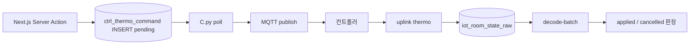
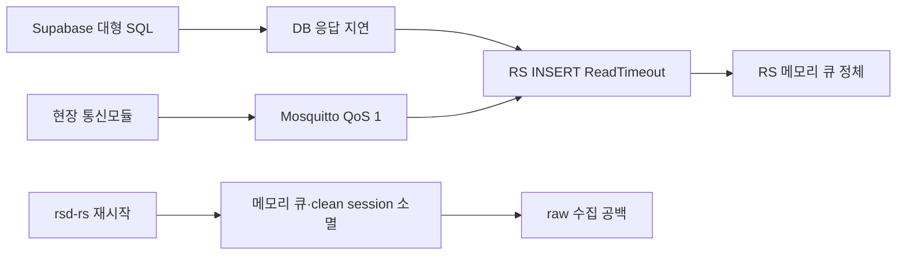

# Instance — EC2 · MQTT · RS/C

> **상위:** [`SYSTEM.md`](./SYSTEM.md) §2.1 · **배포:** [`CLOUD_DEPLOY.md`](./CLOUD_DEPLOY.md)  
> **작성 원칙:** 설계 이유 → 경로 → 운영. 비밀값·키는 문서에 기록하지 않는다.

---

## 1. 설계 이유

| 결정 | 설계 이유 | 하지 않은 것 | 근거 |
|------|-----------|--------------|------|
| **Instance·Dashboard repo 분리** | `rsd`=상시 MQTT·systemd · `dashboard`=Vercel git 배포. **수집 장애와 UI 릴리스 분리** | 대시보드 repo에 RS/C 통합 · UI를 EC2에서 호스팅 | [`CLOUD_DEPLOY.md`](./CLOUD_DEPLOY.md) |
| **RS는 raw INSERT만** | EC2 blast radius 최소. decode는 upsert·sparse·월 파티션·`last_value` 갱신 → **DB 소유** | RS wire decode(Phase3+ 폐기) · RS sparse 필터 | [`RAW_STORAGE_CHANGE.md`](./RAW_STORAGE_CHANGE.md) · [`DECODED_ROWCOUNT_PLAN.md`](./DECODED_ROWCOUNT_PLAN.md) |
| **C.py는 EC2 유지** | MQTT cmd 구독·long poll·현장 네트워크 근접. **serverless/Vercel 부적합** | Next.js MQTT publish · 농장마다 cmd 브로커 | [`CTRL_THERMO_COMMAND_PHASE_A.md`](./CTRL_THERMO_COMMAND_PHASE_A.md) · [`protocol/데이터폼_정책문서.md`](./protocol/데이터폼_정책문서.md) §4 |
| **헬스→DB 적재** | admin DAG가 **DB만** 읽어 전국 상태. EC2 SSH 없이 관측 | Prometheus만 별도 · 대시보드가 EC2 SSH | [`PROJECT_CONTEXT.md`](./PROJECT_CONTEXT.md) §6 |
| **공유 수집 Instance** | MQTT 브릿지 **1벌** · 다농장 topic multiplex. 운영 인력·키 관리 단순 | **농장별 EC2** · tenant별 MQTT 클러스터 | [`SYSTEM.md`](./SYSTEM.md) §1.7 |

### 1.1 RS-DB-C에서 Instance 위치

Instance는 **R(Receive)** 계층만 담당한다.

- **uplink:** 현장 → MQTT → `RS.py` → `iot_room_state_raw`
- **downlink:** `ctrl_thermo_command` → `C.py` → MQTT → 현장
- **decode·LIVE view·UI:** Instance 밖 (Supabase Edge + Vercel)

과거 D.py가 EC2에서 decoded INSERT 하던 경로는 **폐기**. 현행 decode 소유는 [`decode-batch`](../supabase/functions/decode-batch/) ([`CLOUD_DEPLOY.md`](./CLOUD_DEPLOY.md)).

### 1.2 농장별 Instance를 쪼개지 않은 이유

| 고려 | 공유 Instance | 농장별 Instance |
|------|---------------|-----------------|
| MQTT·TLS·키 | 1벌 운영 | N벌 중복 |
| topic | `sungil/{farm}/{item}/raw` multiplex | 브로커 분산 |
| blast radius | RS=raw-only로 이미 축소 | 농장 격리 ↑ · 비용 ↑ |
| 운영 | systemd·헬스 1 DAG | N대 SSH·패치 |

**결론:** 다농장 규모에서 **운영 단순성**이 우선. 장애 격리는 decode=DB·UI=Vercel 분리로 충분.

---

## 2. 경로·객체

### 2.1 저장소·배포

| 구분 | 경로 | 비고 |
|------|------|------|
| EC2 repo | `https://github.com/SIJackLee/rsd` | dashboard repo와 **분리** |
| Dashboard | `dashboard/web` → Vercel | Instance 코드 없음 |
| 레퍼런스 | `Operation/RSD/` | 로컬 참고용 |

### 2.2 프로세스·systemd (문서화된 이름)

| 유닛/프로세스 | 역할 | 재시작 (예) |
|---------------|------|-------------|
| `RS.py` / `rsd-rs` | MQTT → raw INSERT | `sudo systemctl restart rsd-rs` |
| `C.py` / `rsd-c` | pending 명령 → MQTT downlink | Health C 그래프 연동 |
| `rsd-healthcheck.timer` | mqtt/rs/c·mem·disk → DB | 주기는 `instance_health_current.checked_at`으로 관측 |
| `wire_decode.py` (EC2) | Phase3 레거시 보조 | **주력 decode는 Edge** |
| `D.py` | decoded INSERT (레거시) | **폐기** |

**Instance 실측 경로 (SSH/rsd repo 아님):** `/admin/ops` Health DAG · DB `instance_health_current` · [`fetch-instance-health.ts`](../src/lib/admin/health/fetch-instance-health.ts). 아래 §2.3 표 참고.

### 2.3 Health로 보는 Instance 실측

| Health 필드 / 노드 | Instance 의미 | triage |
|--------------------|---------------|--------|
| `checked_at` | healthcheck 주기·신선도 | >10m warn · >30m unknown |
| `mqtt_status` · `mqtt_listen` · `mqtt_roundtrip` | 브로커·구독 | uplink+downlink 공통 |
| `rs_status` · `rs_active` | RS.py | raw INSERT |
| `c_status` · `c_active` | C.py | 명령 downlink |
| `raw_last_received_at` | 최신 uplink | LIVE empty 1차 |
| `command_last_sent_at` | 최신 downlink | sent stuck 1차 |
| `mem_available_mb` · `disk_used_percent` | EC2 자원 | warn 임계 §3.1 |
| `payload` · `note` | rsd 부가 JSON | drill-down (있을 때) |

조회: admin `/admin/ops` · SQL `instance_health_current` (service_role). **SSH·rsd repo 열람은 장애 runbook 필수 단계가 아님.**

### 2.4 MQTT · raw INSERT

| 항목 | 내용 |
|------|------|
| QoS | uplink QoS1 (재전송·버퍼 replay 가능) |
| topic 예 | `sungil/FARM02/P00/raw` ([`RAW_STORAGE_CHANGE.md`](./RAW_STORAGE_CHANGE.md)) |
| INSERT 대상 | `iot_room_state_raw` |
| Phase 3/4 필드 | `topic` + `payload_bytea` + `received_at` (passthrough 컬럼 DROP) |
| `received_at` 의미 | **EC2/DB 수신 시각** — LIVE 신선도·2h hot view 기준 |

### 2.5 Downlink (C.py)



| 상태 | 의미 | 소비자 |
|------|------|--------|
| `pending` | 대시보드 insert 직후 | C.py poll |
| `sent` | MQTT publish 완료 | Health 24h · ACK 대기 |
| `applied` | uplink thermo와 payload 일치 | UI 피드백 |
| `failed` / `cancelled` | 실패·만료 | triage |

- **대시보드:** insert까지 ([`controllers/actions.ts`](../src/app/(dashboard)/controllers/actions.ts))
- **MQTT 전송:** C.py만 — 브라우저·Next API 직통 **금지**
- **TTL:** `ttl_sec=300` (DB auto-cancel 없음 — stale는 Health로 관측)

### 2.6 헬스 스냅샷

| DB 객체 | 적재 주체 | 주요 컬럼 |
|---------|-----------|-----------|
| `instance_health_current` | `rsd-healthcheck` | `mqtt_status`, `rs_status`, `c_status`, `mqtt_listen`, `mqtt_roundtrip`, `rs_active`, `c_active`, `disk_used_percent`, `mem_available_mb`, `raw_last_received_at`, `command_last_sent_at`, `checked_at` |

**소비:** [`fetch-instance-health.ts`](../src/lib/admin/health/fetch-instance-health.ts) → `/admin/ops` (service_role).

---

## 3. 운영

### 3.1 정상 기준

| 신호 | 정상 | 주의 | 무시/치명 |
|------|------|------|-----------|
| `checked_at` | ≤10분 | >10분 warn | >30분 per-service unknown |
| mem | ≥200MB avail | <200MB warn | RS 노드 합산 |
| disk | ≤85% | >85% warn | |
| raw | `raw_last_received_at` 최신 | 2h+ 무신호 | uplink 중단 triage |
| C | `command_last_sent_at` 갱신 | sent 24h+ stuck | [`CTRL_THERMO_COMMAND_PHASE_A.md`](./CTRL_THERMO_COMMAND_PHASE_A.md) |

상수: `INSTANCE_HEALTH_STALE_WARN_SEC=600`, `INSTANCE_HEALTH_STALE_UNKNOWN_SEC=1800` ([`constants.ts`](../src/lib/admin/health/constants.ts)).

### 3.2 장애 시나리오

#### raw 공백 (LIVE 전체 empty)

1. `instance_health_current`: mqtt listen/roundtrip · `rs_status`
2. Supabase: `SELECT max(received_at) FROM iot_room_state_raw WHERE ...`
3. MQTT topic·현장 통신모듈 전원
4. RS 재시작 (롤백 예): `cp wire_decode.py.bak.phase3 wire_decode.py && sudo systemctl restart rsd-rs`

#### MQTT 끊김

- Health: `mqtt_status`, `mqtt_listen`, `mqtt_roundtrip`
- RS/C 모두 영향 — **수신·명령 동시 장애** 가능

#### C sent stuck

1. Health C 그래프 · `ctrl_thermo_command` where `status=sent` and age > TTL
2. C.py systemd · MQTT cmd topic
3. uplink ACK: LIVE thermo vs command payload ([`FARM02_ACK_TRIAGE.md`](./FARM02_ACK_TRIAGE.md))

#### decode는 정상인데 UI만 empty

→ Instance가 아닌 **read path** ([`SYSTEM_DB.md`](./SYSTEM_DB.md) · [`SYSTEM_NEXTJS.md`](./SYSTEM_NEXTJS.md)).

### 3.3 변경·롤백

| 작업 | 승인 | 롤백 |
|------|------|------|
| RS wire_decode 교체 | 운영 | `.bak.phase3` 복원 + restart |
| systemd·env 변경 | 운영 | rsd repo 커밋 revert |
| EC2 force·키 로테 | **명시 승인** | rsd + Supabase 동시 |

### 3.4 알려진 gap / 백로그

- **FARM02 ACK·현장** — uplink/장비 반영 triage ([`FARM02_ACK_TRIAGE.md`](./FARM02_ACK_TRIAGE.md)) · 필요 시 브로커 `/cmd`·`/raw` 모니터
- **외부 연계** — Health DAG Ekape/FTP **미구현** (대기 노드 정합)
- **Health `payload`→운영 문서** — topic 규칙 등 rsd JSON이 Health에 실리면 §2.3 표에 매핑 추가 (선택)

---

## 4. 참고

| 문서 | 내용 |
|------|------|
| [`SYSTEM.md`](./SYSTEM.md) | RS-DB-C 전체 · §1.7 횡단 설계 |
| [`SYSTEM_DB.md`](./SYSTEM_DB.md) | raw·decode·명령 테이블 |
| [`SYSTEM_RUNBOOK.md`](./SYSTEM_RUNBOOK.md) | 장애 대응 순서 |
| [`RAW_STORAGE_CHANGE.md`](./RAW_STORAGE_CHANGE.md) | Phase 1–4 raw 슬림 |

---

## 5. 로컬 FARM01 LIVE 시뮬

회사 MQTT/RS/`Operation/simulator` 원본 없이, 이 저장소만으로 FARM01/P00 LIVE를 올린다.

`simulator/sim_pilot_farm01.py --mqtt` 가 v0x0C **83바이트**를 MQTT 브로커로 보낸다. 호스트·포트·topic은 환경변수 `MQTT_HOST`, `MQTT_PORT`, `MQTT_TOPIC`이다. 미설정 시 호스트는 `127.0.0.1`이고, 운영 브로커 주소는 문서와 코드에 두지 않는다. RS/C/command_ack는 클라우드가 처리한다. `/cmd`를 구독해 thermo를 덮어쓴 뒤 즉시 `/raw`를 한 번 더 올린다.

대상 컨트롤러(과거 FARM01 실측 키): `SP02:01:01`, `SP03:01:01`~`06`, `SP05:01:01`~`06`.

기본은 컨트롤러마다 온·습 시나리오를 **20초**씩 순환한다(위상만 어긋남). `--mqtt`만 켜면 적용된다. 알람 띠 안(정상)·띠 가장자리(주의)·띠 밖(위험)을 한 화면에 같이 보여 필드 덮개·생성 칸의 알람 색을 확인한다.

차트용 이력은 같은 시나리오를 **6시간** 칸으로 `iot_room_state_decoded`에 덮어 썼다(당시 구 DB 실측 · 이 농장만. raw는 그대로). 2026-08-27에 경보 JSON(10.0/43.6)까지 맞춰 다시 씀. 현재 운영 DB는 `fkkrjljeqxpbmazfnync`이다.

파일럿도 현장과 같이 **83바이트**(습도 뒤 저온·고온 경보 4바이트, 설정·측정 온도 원점 500=0℃). 디코더는 예전 79바이트(원점 0)도 받는다. 패킷 시각이 서울 벽시계를 UTC 초처럼 넣은 경우(+9h) Edge가 측정 시각을 보정한다. 파일럿 unix는 UTC라 이 보정은 타지 않는다.

| 항목 | FARM01 파일럿 |
|------|----------------|
| topic | 환경변수 `MQTT_TOPIC`. 미설정 시 시뮬레이터 기본 topic |
| tempsC | 프로브 4개, 원점 500 |
| 경보 | 저온 10.0℃ / 고온 43.6℃ |
| Channel A | `EC03` + 출력 + thermo 25.0/2.0/10/80 |
| Channel B | `EC02` + 출력 + thermo 24.0/1.5/5/90 (`SP02`는 없음) |
| Channel C | 비움 |

`web/.env.local` 에 `NEXT_PUBLIC_SUPABASE_URL`, `SUPABASE_SERVICE_ROLE_KEY` 가 있어야 한다.

```bash
cd dashboard
python simulator/sim_pilot_farm01.py --self-test
python simulator/sim_pilot_farm01.py --mqtt          # 시나리오 순환 (20초)
python simulator/sim_pilot_farm01.py --mqtt --once
```

확인: 로컬 `http://localhost:3000/farm?lsind=FARM01&item=P00` 또는 배포본. `--write` 없이 실행하면 INSERT 하지 않는다.

| 항목 | 내용 |
|------|------|
| DB | 운영 `fkkrjljeqxpbmazfnync` `iot_room_state_raw` INSERT + decode |
| MQTT/EC2 | 사용 안 함 |
| 명령 downlink | 없음. 집 시뮬은 `/cmd` 미구독. `/raw`는 DB 직접 INSERT로 EC2 RS를 우회 |
| 충돌 | 현장 모듈이 같은 FARM01을 올리면 값이 섞임. 당시 FARM01 raw는 2026-08-14 이후 끊김 |

FARM01 실측(2026-08-11): `SET_CHANNEL_THERMO` pending→sent ≈1.3s, sent→applied ≈4s. 채널 A=`EC03` / B=`EC02`.

---

## 6. 2026-09-17 RS 수집 공백

## 2026-09-17 RS 수집 공백과 재발 방지

> 상태: 서비스 복구 · 유실 구간 복구 불가 · 재발 방지 체크는 [`OPS.md`](./OPS.md) 런북의 「미결 — 2026-09-17」
> 대상: EC2 `rsd-rs` → Supabase `iot_room_state_raw`

### 1. 현상과 영향

2026-09-17 Supabase에 큰 SQL 작업이 실행된 뒤 RS의 Supabase HTTPS INSERT가
`ReadTimeout`으로 정체됐다. `rsd-rs`는 systemd에서 `active (running)`이었지만
새 raw 행을 저장하지 못했다.

- 마지막 정상 저장: **17:14 KST** (`08:14 UTC`)
- 저장 재개: **18:49 KST** (`09:49 UTC`)
- DB 수집 공백: 약 **95분**
- 영향: 해당 구간 LIVE·시계열 raw 누락
- 비영향: Mosquitto 수신과 `rsd-c` 명령 에이전트

대형 SQL과 장애의 시간적 선후관계는 확인됐지만, Supabase 로그로 직접적인
자원 고갈 원인까지 확정한 것은 아니다. 직접 확인된 RS 오류는 로그인 실패가
아니라 Supabase HTTPS 응답 `ReadTimeout`이다.

### 2. 장애 흐름



`sudo systemctl restart rsd-rs` 후 MQTT 재구독과 DB 저장이 정상화됐다.
복구 직후 저장된 행은 백로그 burst가 아니라 기존 약 5분 주기의 신규
`history=false` 데이터였다.

### 3. 기존 데이터가 복구되지 않은 이유

- RS MQTT 연결 로그가 `c1`(clean session)이어서 재접속 시 브로커 세션 큐가 폐기됐다.
- RS에는 DB 저장 전 payload를 보존하는 디스크 Outbox가 없다.
- RS 재시작으로 프로세스 메모리 큐가 사라졌다.
- 해당 EC2 EBS 볼륨의 장애 시점 스냅샷이 없다.
- 2026-01-08 AMI는 장애 이전 데이터 복구에 사용할 수 없다.
- 현장 통신모듈은 이 구간의 전송 이력을 재생할 버퍼를 보유하지 않는다.

### 4. 재발 방지

체크·완료 조건·롤백의 정본은 [`OPS.md`](./OPS.md) 런북의 「미결 — 2026-09-17」절이다.

## 변경 이력

| 날짜 | 내용 |
|------|------|
| 2026-10-12 | 로컬 FARM01 LIVE 시뮬을 §5로 흡수 |
| 2026-10-12 | 2026-09-17 수집 공백 원인을 §6으로 흡수. 재발 방지 체크는 런북 |
| 2026-09-01 | 초안 — 설계 이유·경로·운영 (Canvas §2.1 승인 반영) |
