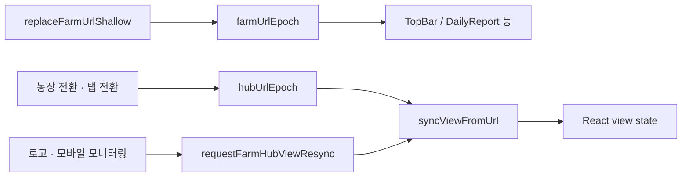

# `/farm` 허브 URL · 셸 계약

허브 셸·라우팅 소유. 구현: `src/lib/farm/farm-view-url.ts`, `farm-page-content.tsx`.  
Cursor 규칙: `.cursor/rules/farm-shell-routing.mdc`.

디자인(모션)·ARIA(프로토콜)는 이 스키마를 **소비만** 하고 키 의미를 바꾸지 않는다.

---

## Feature flag — 필드 통합 (P0)

| 환경변수 | 기본 | 설명 |
|----------|------|------|
| `NEXT_PUBLIC_FARM_FIELD_MERGE_V1` | **on** (`false`/`0`/`off`만 끔) | 그리드·목록 → «필드» 탭. off면 그리드·목록·차트 분리 |

통합 on일 때 UI:
- 상위 탭: **필드 · 차트**
- 판정 단위는 **컨트롤러 영향범위**(카드 1장). 방 칸 히트맵 탭(`view=status`)은 제거. 옛 주소는 필드로 정규화
- PC 필드: ScopeBar 스티키 없음 — 농장 선택은 **계정 메뉴**, 보기 탭은 **TopBar**
- 모바일 compact: 보기 탭은 **하단 독** (`DashboardViewportShell`)
- 좌 카드 선택 → 우측 **해당 축사 컨트롤러만**. 「전체보기」·같은 카드 재탭으로 전체 복귀
- 좌 현황 숨기기/나타내기 · 카드 헤더 단일 순환 버튼
- 모바일: 그리드만 + 카드 탭 시 Bottom sheet 직행 (인라인 상세 없음)
- 모바일 상세 «차트로 옮기기»: 차트 탭으로 이동하며 그 그래프가 **펼쳐집니다**. 필드 탭으로 돌아와도 `chartW1`/`chartW2`는 유지

레이아웃 (통합 on):

- PC(`lg+`): 맵|표 밀도 토글 없음. 좌측 카드는 상태 면색 + 명칭 + 온·습도(히트맵 없음). 펼침 15rem / 접힘 2.5rem, 너비 전환 `duration-motion-moderate`
- 필터 전환: exit fade(150ms) → 교체 → stagger enter(40ms, `ui-motion-stagger-in`). 좌측 선택 시 해당 컨트롤러 스크롤·하이라이트
- 카드 헤더 「축사유형 N번 축사」/`컨트롤러 M` + 단일 순환. 컨트롤러는 그래프 → 설정 → 그래프. 일괄 그래프는 설정 → 그래프 → 설정. 일괄 설정은 그래프 → 설정 → 그래프
- 모바일: 축사 카드·시트 제목·컨트롤러 피커는 아이콘+번호(축사 창고 마크 · 컨트롤러 장치 마크). 시트 안 그래프/설정이 컨트롤러 역할. 라인은 LTTB·점 마커 없음·핀·카드 유지. 구간 줌 없음
- 기능 안내: 필드 PC·모바일 `TOUR_VERSION` 24+. 차트 42+(축사유형 평균 → 유형 칸 → 축사번호 평균 → 축사 펼침 → 표시 레이어 → 온·습 상·하한. 목록은 30일, 펼친 카드는 휠. 차트에서 컨트롤러 명령은 보내지 않음)
- 구현: `farm-page-content.tsx`, `farm-field-status-grid.tsx`, `top-bar.tsx`(`data-farm-view-toggle-slot="desktop"`), `dashboard-viewport-shell.tsx`, `account-menu.tsx`

---

## 쿼리 키

| 키 | 값 | 기본 | 설명 |
|----|-----|------|------|
| `lsind` / `item` | 농장 키 | (권한·서버) | 활성 농장. soft home에서 **유지** |
| `view` | `list` \| `chart` \| (`chartlab`→차트, `aria`/`jarvis`/`status`/`plan`/`model`→필드) | **없음 = 그리드(map)** | 상단 탭. 옛 델린·현황 히트맵·모델 주소는 필드. `chartlab`은 `chart`로 정규화 |
| `trendPeriod` | `24h` \| `30d` | **없음 = 7d** | 그리드·목록·차트 공유 기간. 기본 `7d`는 URL 생략 |
| `sp` | 축사유형 코드 | — | 그리드 드릴 (SP 그래프) |
| `mapLevel` | `stalls` | 없음=sp | 그리드 드릴 단계 |
| `stall` | 축사번호 | — | 그리드 컨트롤러 포커스 |
| `listMode` | `controller` \| `graph` \| `settings` | `controller`(생략) | 목록 탭 모드. 레거시 `channel`은 **읽기만** `graph`로 매핑·정규화 |
| `listLayout` | `group` | 없음=`flat` | 목록 레이아웃 |
| `ctrl` | 컨트롤러 키 | — | 목록 포커스 |
| `alarm` | 알람 id | — | 딥링크 |
| `chartSp` | 축사유형 코드 | — | 차트 집계 (유형). 맵 `sp`와 분리 |
| `chartStall` | 축사번호 | — | 차트 집계 (축사). `chartSp` 필요 |
| `chartCtrl` | 컨트롤러 키 | — | 차트 집계 트리 선택(컨트롤러). `chartSp`+`chartStall` 필요. 명령 이력 대상. `URLSearchParams`가 인코딩함. 옛 `%253A` 이중 인코딩은 읽기에서 복원 |
| `chartW1` / `chartW2` | `축사유형\|축사번호\|컨트롤러키` 또는 `-` | — | 목록·펼침 선택. **3칸**. 4칸 이상(키가 한 번 더 붙은 옛 URL)은 앞 3칸만 사용. `-`는 빈 칸(집계 딥링크 재시드 방지). 없으면 `chartCtrl`을 위로 시드. 칸 없음=목록(축사유형 평균), `W1`만=해당 **컨트롤러 개별 그래프**. `W1`+`W2`=두 컨트롤러 개별 그래프 비교(다른 축사·유형도 가능) |
| `chartYBand` | `temp` \| `hum` \| `motor` (+로 복수). 레거시 `command`는 `chartCmd`로 해석 | — | 지표 집중(Y밴드). 칩·드래그 |
| `chartCmd` | `1` | — | 컨트롤러 집계에서 온도·모터 본선 **명령 이력**(A/B/C 창·선). 집계 트리 컨트롤러 행 「명령」 토글 |
| `chartX0` / `chartX1` | 0–1 비율 | — | 집중·줌의 시간 구간(전체면 생략) |

레거시 `tab=ops|…` 는 미들웨어·페이지에서 `/farm`으로 정리. 신규 코드는 `tab` 쓰지 않음.

레거시 `listMode=channel`: `parseListViewMode` → `graph`. 목록 탭 진입 시 `normalizeLegacyListModeParam`으로 URL을 `graph`로 고쳐 씀 (쓰기·타입에 `channel` 없음).

---

## 탭 (`view`)

```
resolveFarmHubView(raw)
  list  → list
  chart → chart
  chartlab → chart  // 옛 테스트 탭
  plan | model → map  // 은퇴한 모델 탭
  aria | jarvis → map   // 옛 델린 탭
  status → map          // 레거시 현황(방 칸 히트맵) 탭
  else  → map   // view 없음·알 수 없음
```

| 전환 헬퍼 | 부수 효과 |
|-----------|-----------|
| `applyMapGridParams` | `view`·`listMode`·drill·집계·줌·명령·잔여 `plan*` 제거. **위젯 칸(`chartW1`/`chartW2`)은 유지** |
| `applyListViewParams` | `view=list`, `stall`·`mapLevel` 제거 (`sp` 유지 가능). 잔여 `plan*` 정리 |
| `applyChartViewParams` | `view=chart`, `listMode`·`stall`·`mapLevel` 제거 (`chart*` 유지). 잔여 `plan*` 정리 |
| `applyChartLabViewParams` | `applyChartViewParams`와 동일 (옛 `view=chartlab`) |
| `applyAriaViewParams` | 필드(그리드)로 정규화. 옛 `view=aria` 호환 |
| `applyHubScopedViewParams(view)` | 위 + 레거시 `tab` 삭제 |
| `pinFarmHubViewParam(view)` | **탭만** 고정. `list`/`chart`는 `view` 유지. `chartlab`→`chart`. drill·`chart*` 유지 (기간 변경용) |

### 차트 집계 딥링크

- 헬퍼: `resolveFarmChartScope` / `applyFarmChartScopeParams` / `clearFarmChartScopeParams` (`farm-chart-scope.ts`)
- 범위 변경: shallow + `pinFarmHubViewParam(chart)` — **hub epoch 올리지 않음**
- 목록·soft home·농장 전환 시 `chart*` 전부 제거. 필드(맵) 전환은 집계·줌·명령만 제거하고 위젯 칸은 유지
- 예: `/farm?lsind=…&item=…&view=chart&trendPeriod=7d&chartSp=SP03&chartStall=1`
- 줌 예: `chartYBand=temp+command&chartX0=0.2&chartX1=0.6` — 온도·명령 레인 집중 + 시간 구간
- 목록·펼침 계약: `farmChartLabSelectionFromWidgetSlots` / `applyFarmChartLabSelectionParams`. 차트 탭이 이 계약을 화면에 쓴다. `W1`+`W2`는 비교 모드. 아래칸만 있으면 기준으로 올려 위칸에 쓴다. `chartSp`/`chartCmd`/`chartYBand`/`chartX0`는 읽기만 유지

---

## Soft home

농장·기간만 남기고 탭/드릴/목록모드를 벗긴 **그리드 홈**.

- 헬퍼: `buildFarmMonitoringHomeParams` / `buildFarmMonitoringHomePath` / `isFarmMonitoringSoftHome`
- 진입점:
  - PC: 좌측 상단 로고 (`AppHeaderBrand`)
  - 모바일 compact: 로고 홈 · 하단 보기 독은 탭 전환용 (구 «모니터링» 하단 내비와 별개)
- 유지: `lsind`, `item`, `trendPeriod`(7d|30d)
- 제거: `view`, drill, `listMode`, `ctrl`, `alarm`, `chart*`, `plan*`
- 이미 soft home이면 no-op

농장 전환 시: `clearHubFarmDrillParams` + 새 `lsind`/`item` (기간은 유지하는 편이 일반적).

**Capacitor(네이티브):** shallow/`router.push`만 쓰면 `window.location`과 RSC 스코프가 어긋나 허브 빈 문구가 남을 수 있다.  
`FarmSwitcher`는 네이티브에서 `window.location.assign`으로 document 로드해 SSR 단건 패널을 확정한다.

---

## Shallow URL vs Next `useSearchParams`

탭·드릴·기간은 주로 `window.history.replaceState` (`replaceFarmUrlShallow`).

| API | 용도 |
|-----|------|
| `currentFarmSearchParams()` | `/farm`에서 **읽을 때** 기준 (window) |
| `replaceFarmUrlShallow(params)` | 쓰기 + `farmUrlEpoch` bump |
| `useSearchParams()` | SSR·첫 페인트·비 shallow 경로. `/farm` 재작성 소스로 쓰지 말 것 |

---

## Epoch · view sync

의도적 **이중(+resync)** 구조. 합치지 말 것.



| 채널 | bump 시점 | 구독 |
|------|-----------|------|
| `farmUrlEpoch` | 모든 shallow / popstate | `subscribeFarmUrlEpoch` |
| `hubUrlEpoch` | 농장·탭 전환 (`onHubUrlChange` / notify) | `FarmPageContent` effect |
| `requestFarmHubViewResync` | Provider **밖** soft home | `subscribeFarmHubViewResync` |
| `liveFarmHubView` | React 탭 state와 동기 (`publishLiveFarmHubView`) | 차트 본문 높이 채움 (`FarmPageViewport`) |

차트 탭 높이는 URL `view`가 아니라 **화면 탭 상태**를 따른다. 진입 직후 칸을 열어도 남는 높이를 쓴다.

**금지:** 기간(`trendPeriod`)만 바꿀 때 `onHubUrlChange` / `requestFarmHubViewResync`  
→ URL에 `pinFarmHubViewParam` + `replaceFarmUrlShallow` + `urlTick`만.

단일 UI 진입점: `FarmPageContent`의 `syncViewFromUrl`  
(hydrate / hubUrlEpoch / resync / 비허브 searchParams).

---

## 탭 keep-alive (패널 마운트)

### 목록 카드 로컬 기간 (`panelPeriodOverrides`)

목록 탭에서 개별 카드가 공유 `trendPeriod`와 **다른** 기간을 잠깐 볼 수 있다(URL에 쓰지 않음).  
공유 기간 변경·목록 탭 언마운트 시 로컬 override는 초기화된다.

그리드(`map`)는 **항상** 마운트. 목록·차트는 첫 방문 후 DOM에 남겨 재진입을 빠르게 하고, 이탈 후 TTL이 지나면 언마운트한다.

| 패널 | TTL | 비고 |
|------|-----|------|
| list | 5분 | BarnTable·enrich |
| chart | 3분 | `chart*` URL로 범위 복구 |

구현: `src/lib/farm/farm-hub-keepalive.ts` · `use-farm-hub-view-shell.ts` · `FarmPageContent`의 패널 렌더.

- 슬라이드 중(`viewSlide`) 해당 패널 언마운트 금지
- 농장 키 변경 시 비활성 패널 keep-alive **즉시 flush**
- `visibilitychange` → visible 시 TTL 재계산 (백그라운드 만료분 즉시 해제)
- 재진입 시 다시 마운트 (차트 범위는 URL, 목록 스크롤 등은 리셋될 수 있음)
- **P1 live pause:** DOM keep-alive와 별도 — 비활성 패널은 LIVE/enrich/폴링 중지 (`isFarmHubPanelLiveActive`). 캐시 유지 → 재진입 즉시 복구. 목록 enrich는 `view=list`일 때만 ([`farm-hub-url.md`](#허브-본체-안정화--p0-관측·재현-게이트))

---

## 변경 시 주의 (단일 에이전트)

| 변경 | 참고 문서 |
|------|-----------|
| 쿼리 키·의미·soft home·epoch | 본 문서 (정본) |
| 탭 슬라이드·패널 모션 | `UI.md` · `motionClass`만 소비 |
| `view=aria` (호환) | 필드 정규화. 뱃지·권장 안내는 제거 · [`farm-hub-url.md`](#환경-상태-정책) |
| `view=plan` · `view=model` | 은퇴. 필드로 정규화 |
| `view=chartlab` | 옛 테스트 탭. `view=chart`로 정규화 |

---

## 관련 문서

- 사용설명서 IA: [메뉴구조도](./user-manual/README.md#10-메뉴구조도)
- 환경 상태: 이 문서의 「환경 상태 정책」. DELIN 뱃지·권장 안내는 제거되었다
- 문서 진입점: [README.md](./README.md)
- Preview 게이트 절차: [OPS.md](./OPS.md#preview-게이트)
- 허브 안정화 P0: 이 문서의 「허브 본체 안정화」 (`npm run verify:hub` · `npm run smoke:hub-url`)
- 로그인 후 브라우저 스모크: `npm run smoke:hub-url` (dev 또는 Vercel)
  - 로컬: 기본 `http://localhost:3000`
  - 배포본: `UI_VERIFY_BASE=https://<preview-or-prod>.vercel.app npm run smoke:hub-url`
  - 전제: 배포 env의 Supabase와 로컬 `.env.local`이 **동일 프로젝트** (테스트 계정)

---

## 환경 상태 정책

DELIN 및 축사유형·일령별 환경 권장 정책을 제거했습니다.

- 환경 판단: RAW의 컨트롤러 공통 저온·고온 경보값.
- 경보값 미수신 또는 유효하지 않은 값: 확인 필요/미판정. 유형별 권장값으로 대체하지 않습니다.
- 습도: 실측값과 추이는 표시하지만 권장값·사용자 습도 알림으로 판정하지 않습니다.
- 이상상황: 모듈 오류, 통신 두절, 장비 온도 경보값 초과.
- 차트: 권장선은 제거. 공통 장비 경보값이 있으면 현재 경보선을 표시하며, 서로 다르거나 미수신이면 숨깁니다. 축 계산용 기본 범위는 경보 기준이 아닙니다.
- PDF: 농장 표지와 축사유형별 실측 추이·수신 현황. 권장 통계와 최장 이탈 페이지는 제거. 현재 공통 장비 경보선은 참고선이며 과거 경보 발생시간을 계산하지 않습니다.
- 기존 RAW, DB, AWS 전송/ACK 및 0x0D·0x0E 명령 프로토콜은 변경하지 않습니다.

DELIN 전용 UI·정책표·출시 게이트 및 `NEXT_PUBLIC_DELIN_ENABLED` 코드 의존성은 제거했습니다.
### 센서값 미수신 표시 (2026-10-08)

NaN·Infinity·null·undefined 측정값은 숫자로 표시하지 않고 `—`로 표시하며 단위도 붙이지 않습니다. 0은 유효한 측정값으로 유지합니다. 상세·접근성 안내는 ‘습도값 미수신’처럼 센서 종류를 명시합니다. 유효한 값만 농장 평균에 포함합니다. 삭제되었거나 수신하지 못한 경보 기준의 게이지·임계값 배지는 표시하지 않습니다. 실제 측정값은 경보 기준 유무와 독립적으로 표시합니다. PDF·브리핑도 미수신값에 단위를 붙이지 않습니다. 통신 상태·수신 시각 표시와 기존 오프라인 수치 숨김 정책은 유지합니다.

---

## 허브 본체 안정화 — P0 (관측·재현 게이트)

> 정본 URL 계약: [`farm-hub-url.md`](./farm-hub-url.md)  
> P0 범위: **앱 동작 변경 없이** 회귀 게이트·체크리스트·관측 절차만 고정.

---

### 자동 게이트 (서버 불필요)

```bash
cd dashboard/web
npm run verify:hub
```

| 파일 | 커버 |
|------|------|
| `src/lib/farm/farm-hub-url-smoke.test.ts` | 차트 딥링크 · soft home · 기간+탭 유지 · 탭 URL 왕복 · 농장 전환 drill 클리어 |
| `src/lib/farm/farm-hub-keepalive.test.ts` | TTL · 슬라이드 중 언마운트 금지 · 농장 flush 플래그 |

`npm test`에도 포함됨. 허브 작업 중에는 `verify:hub`만 먼저 돌려도 된다.

---

### 브라우저 스모크 (dev 또는 배포)

```bash
# 로컬: npm run dev 실행 중
npm run smoke:hub-url

# 배포본
UI_VERIFY_BASE=https://<preview-or-prod>.vercel.app npm run smoke:hub-url
```

스크립트: `scripts/farm-hub-url-manual-smoke.mjs`  
전제: `.env.local` Supabase = 배포 env · 테스트 계정.

| # | 시나리오 | 자동화 |
|---|----------|--------|
| 1 | 차트 딥링크 · 새로고침 | ✓ |
| 2 | 로고 soft home | ✓ |
| 3 | 기간 변경 시 차트 유지 | ✓ |
| 4 | `listMode=channel` → graph | ✓ |
| 5 | 탭 왕복 그리드↔목록↔차트↔ARIA | ✓ |

---

### 수동 관측 체크리스트 (P0)

허브 작업 전·후 한 번씩. 실패 시 URL·네트워크·콘솔을 기록하고 **P1에서 수정**.

| # | 항목 | 확인 |
|---|------|------|
| M1 | 탭×4 왕복 후 URL·활성 패널 일치 | `smoke:hub-url` #5 또는 수동 |
| M2 | soft home (로고 / 모바일 모니터링) | #2 |
| M3 | 기간만 변경 — 탭·chart 범위 유지 | #3 |
| M4 | 차트 딥링크 새로고침 | #1 |
| M5 | 농장 전환(admin) — drill/탭 초기화·기간 유지 | **PASS** (2026-07-30 수동 · 이상 없음) |
| M6 | 탭 숨김 → 복귀 — LIVE 폴링 폭주 없음 | **PASS** (2026-07-30 수동 · 이상 없음) |
| M7 | 목록·차트·ARIA 방문 후 그리드만 — 메모리/네트워크 이상 없음 | **PASS** (2026-07-30 수동 · 이상 없음) |

#### M6 · M7 관측 방법

1. Chrome DevTools → Network (Fetch/XHR) · Performance/Memory  
2. `/farm` 로그인 → 목록·차트 각 1회 진입 후 그리드로 복귀  
3. 다른 앱 탭으로 전환(숨김) 30초 → 복귀  
4. 숨김 중·복귀 직후 `live` / Supabase 요청이 **활성 탭 수준**인지 기록

결과를 이 문서 또는 이슈에 p50/p95·maxInFlight로 남긴다. 기준 참고: [`QA_RECORD.md`](./QA_RECORD.md) · [`QA_SHIP_GATE.md`](./QA_SHIP_GATE.md#출고-스모크).

---

### P1 — 비활성 패널 LIVE pause (구현됨)

| 대상 | pause 조건 |
|------|------------|
| 목록 `BarnTable` 추이 fetch | `panelLiveActive` = `view===list` |
| ARIA metrics 로드·폴링 | `panelLiveActive` = `view===aria` |
| 셸 controller trend 훅 | `view` ∈ map\|list\|chart (ARIA에서 off) |
| list enrich / idle prefetch enrich | `view===list`만 · ARIA에선 idle prefetch 전체 skip |

헬퍼: `isFarmHubPanelLiveActive` (`farm-hub-keepalive.ts`).  
공유 LIVE slice(맵 적용 후 readings)는 유지 — 명령 ACK 경로와 무관.

#### P1 수동 확인 (M6·M7)

1. 목록·ARIA 각 1회 진입 후 그리드로 복귀  
2. Network에서 목록 추이·ARIA metrics 요청이 **비활성 중 중단**되는지 확인  
3. 목록/ARIA 재진입 시 캐시로 즉시 표시되는지 확인  

---

### 변경 이력

| 일시 | 내용 |
|------|------|
| 2026-07-30 | P0 게이트 `verify:hub` · 유닛/수동 스모크 확장 · 본 문서 |
| 2026-07-30 | 스모크 #4로 `normalizeLegacyListModeParam`이 UI에 미연결임을 발견 → `FarmPageContent.syncViewFromUrl`에 배선 |
| 2026-07-30 | P1: keep-alive 비활성 패널 LIVE/enrich/ARIA poll pause |
| 2026-07-30 | P2: view sync·keep-alive TTL → `use-farm-hub-view-shell` (동작 동일) |
| 2026-07-30 | M5 농장 전환(admin) 수동 관측 PASS · 이상 없음 |
| 2026-07-30 | M6 탭 숨김→복귀 수동 관측 PASS · 이상 없음 |
| 2026-07-30 | M7 keep-alive 후 그리드 백그라운드 부하 수동 관측 PASS · 이상 없음 |

### 로컬 실행 기록 (2026-07-30)

| 게이트 | 결과 |
|--------|------|
| `npm run verify:hub` | PASS |
| `npm run smoke:hub-url` (localhost) | PASS (#1–#5). 중간: #4 미연결 재현→배선, #5 투어 오버레이→스모크에서 건너뛰기 |
| M5 농장 전환 (admin 수동) | PASS · 이상 없음 |
| M6 탭 숨김→복귀 | PASS · 이상 없음 |
| M7 목록·차트·ARIA 후 그리드 | PASS · 이상 없음 |
