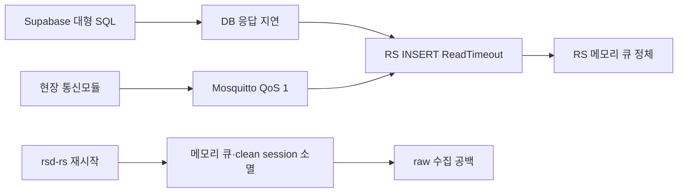

# 2026-09-17 RS 수집 공백과 재발 방지

> 상태: 서비스 복구 · 유실 구간 복구 불가 · 재발 방지 체크는 [`../SYSTEM_RUNBOOK.md`](../SYSTEM_RUNBOOK.md) §8
> 대상: EC2 `rsd-rs` → Supabase `iot_room_state_raw`

## 1. 현상과 영향

2026-09-17 Supabase에 큰 SQL 작업이 실행된 뒤 RS의 Supabase HTTPS INSERT가
`ReadTimeout`으로 정체됐다. `rsd-rs`는 systemd에서 `active (running)`이었지만
새 raw 행을 저장하지 못했다.

- 마지막 정상 저장: **17:14 KST** (`08:14 UTC`)
- 저장 재개: **18:49 KST** (`09:49 UTC`)
- DB 수집 공백: 약 **95분**
- 영향: 해당 구간 LIVE·시계열 raw 누락
- 비영향: Mosquitto 수신과 `rsd-c` 명령 에이전트

대형 SQL과 장애의 시간적 선후관계는 확인됐지만, Supabase 로그로 직접적인
자원 고갈 원인까지 확정한 것은 아니다. 직접 확인된 RS 오류는 로그인 실패가
아니라 Supabase HTTPS 응답 `ReadTimeout`이다.

## 2. 장애 흐름

`sudo systemctl restart rsd-rs` 후 MQTT 재구독과 DB 저장이 정상화됐다.
복구 직후 저장된 행은 백로그 burst가 아니라 기존 약 5분 주기의 신규
`history=false` 데이터였다.

## 3. 기존 데이터가 복구되지 않은 이유

- RS MQTT 연결 로그가 `c1`(clean session)이어서 재접속 시 브로커 세션 큐가 폐기됐다.
- RS에는 DB 저장 전 payload를 보존하는 디스크 Outbox가 없다.
- RS 재시작으로 프로세스 메모리 큐가 사라졌다.
- 해당 EC2 EBS 볼륨의 장애 시점 스냅샷이 없다.
- 2026-01-08 AMI는 장애 이전 데이터 복구에 사용할 수 없다.
- 현장 통신모듈은 이 구간의 전송 이력을 재생할 버퍼를 보유하지 않는다.

## 4. 재발 방지

체크·완료 조건·롤백의 정본은 [`../SYSTEM_RUNBOOK.md`](../SYSTEM_RUNBOOK.md) §8이다.
