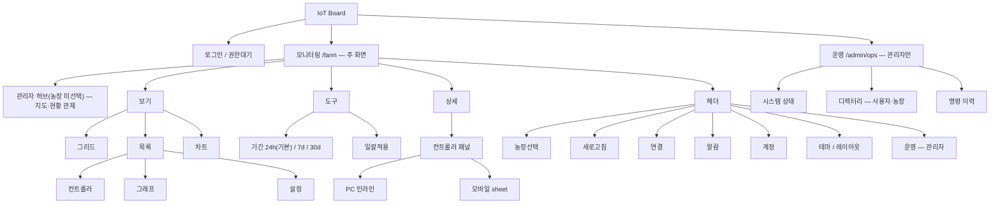
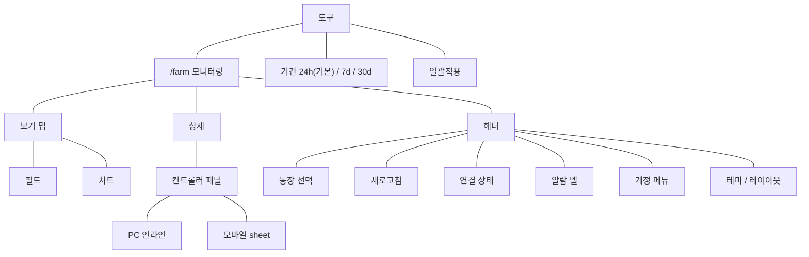
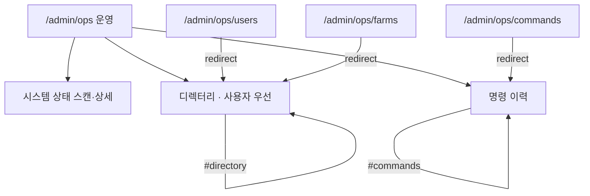

# 스마트 축사 IoT 대시보드 사용설명서

운영자(명령 가능) 중심으로 작성했다. 관리자·뷰어 차이는 「9. 역할별 차이」에 있다.

각 절은 화면 설명이다. PC가 우선이고, 모바일 차이는 「8. 모바일」에 있다.
이미지는 [`images/`](./images/)에 있다. 차트 절 스크린샷은 아직 없다.

개발용 `/farm` URL 계약은 [`../farm-hub-url.md`](../farm-hub-url.md). 문서 허브는 [`../README.md`](../README.md).

예전 `/settings`, `/alarms`, `/controllers`는 모니터링(`/farm`)으로 통합되어 별도 화면이 없다.
스크린샷은 테스트 농장 기준이며, 실고객·운영 비밀값은 포함하지 않는다.

## 0. 시작하기

로그인부터 공통 헤더까지, 대시보드에 처음 들어올 때 보는 화면입니다. 메뉴 전체 구조는 [메뉴구조도](#10-메뉴구조도)를 보세요.

### 로그인

#### 이 화면에서 할 수 있는 것

- **아이디 / 비밀번호**: 관리자에게 받은 계정으로 로그인합니다.
- **로그인**: 성공하면 모니터링(`/farm`)으로 이동합니다. 권한이 아직 없으면 대기 화면(`/pending`)으로 안내될 수 있습니다.
- **테마 토글**(우측 상단): 라이트/다크 모드를 바꿉니다.
- **문의 안내**: 계정이 없거나 접근이 막혀 있으면 관리자에게 요청합니다.

> 테스트·데모 계정 예시는 내부 출고 체크리스트를 참고하세요. 실운영 비밀번호는 문서에 적지 않습니다.

### 공통 헤더 (로그인 후)

모니터링·운영 화면 상단에 공통으로 표시됩니다. 상세는 [헤더와 알람](#5-헤더와-알람)을 보세요.

#### 이 영역에서 할 수 있는 것

- **로고 / 모니터링 홈**: 농장 모니터링으로 돌아갑니다.
- **농장 선택**(관리자·다농장): 모니터링할 농장을 고릅니다.
- **새로고침**: 화면 데이터를 다시 불러옵니다.
- **레이아웃 토글**: PC ↔ 모바일 미리보기 레이아웃을 수동 전환합니다.
- **테마 토글**: 라이트/다크.
- **연결 상태**: 컨트롤러 온라인/오프라인 요약.
- **알람 벨**: 센서·통신 알림 목록.
- **기능 안내**: 헤더 오른쪽 **물음표** — 지금 보고 있는 탭(필드·차트) 안내.
  - 필드: **상단 도구 → 탭 → 좌측 현황 → 목록 도구·컨트롤러·그래프·설정**.
  - 차트: **축사유형·축사번호 → 펼침 → 표시 레이어 → 온·습 상하한 → 기간·구간·환경 양호도**.
  - **DELIN**: 뱃지와 권장 안내는 제거되었습니다. 옛 주소는 필드로 열립니다. → [DELIN 제거](#12-delin--제거됨)
- **계정 메뉴**: 역할 표시, 농장 선택, 최근 활동, 농장 주소 등.
- **로그아웃**: 세션을 종료하고 로그인 화면으로 이동합니다.
- **운영**(관리자만): `/admin/ops` 운영 화면으로 이동합니다.

### 레거시 경로

예전 `/settings`, `/alarms`, `/controllers`는 **모니터링(`/farm`)으로 통합**되어 별도 화면이 없습니다.

---

## 1. 모니터링 — 필드 그리드

축사 배치와 이상 징후를 한눈에 보는 보기입니다.

판정 단위는 **컨트롤러 영향범위**입니다. 방을 칸으로 나눈 히트맵 탭은 쓰지 않습니다.

덮개 하단은 **환경 정상·주의·경고**와 **통신 정상·주의·경고**를 각각 표시합니다. 환경은 사용자 알람 기준, 통신은 기존 데이터 신선도 기준(수신 15분 이내 정상, 15분 초과~60분 주의, 60분 초과 경고; 측정시각 60분 초과 정체도 주의)을 따릅니다. 오래된 데이터나 환경값이 없는 경우 **환경 확인 필요**로 표시하며, 통신 지연 시 마지막 수신 시각을 함께 보여줍니다.

### 그리드 개요

#### 이 화면에서 할 수 있는 것

- **필드 · 차트 전환**: 필드는 컨트롤러 카드, 차트는 추이(축사유형·축사번호)입니다. 권장 온·습 안내와 DELIN 뱃지는 제거되었습니다. → [차트](#11-모니터링--차트) · [DELIN 제거](#12-delin--제거됨)
- **컨트롤러 카드**: 기본은 **정상·주의·위험 색 덮개**. 위는 축사유형명·축사번호·컨트롤러 번호, 가운데는 이탈 이유(지금 값·**알람 띠**), 아래는 판정. 값은 크게, 명칭·판정은 한 단계 낮고 조금 투명합니다. 격자는 순차 등장합니다. 누르면 덮개가 걷히며 명칭은 헤더로, 채움은 카드 테두리로 이어집니다. 지금 값·알람 띠는 온습 구간 테두리에 옅은 빛으로 남고, 덮개에 없던 습도(또는 온도) 막대는 이후에 나타납니다. 명칭을 다시 누르면 같은 모션이 거꾸로 재생되며 덮입니다. **설정에서 명령을 보내면 설정이 열린 채** 보낸 채널 줄이 접수·전송·확인으로 차고, 확인 때 체크가 잠깐 보입니다. 카드·설정이 화면보다 길면 **격자 안을 아래로 밀어** 하단까지 봅니다. 컨트롤러 탭 덮개에서는 가운데 채널 줄로 같은 진행을 봅니다. 채점은 **장비 저온·고온 경보와 사용자 알람 기준·편차**입니다(차트와 같은 값. 띠 안 가장자리는 주의, 띠 밖은 위험). 생육 권장 띠는 제거되었습니다. → [DELIN 제거](#12-delin--제거됨)
- **왼쪽 현황**: 그 축사에 속한 컨트롤러 중 가장 나쁜 알람 판정으로 면색을 칠합니다. 수신이 끊긴 카드만 연결 끊김입니다.
- **일괄적용**(명령 권한 있을 때): 토글을 켜면 덮개 없이 축사 선택 모드로 바뀝니다. → [일괄적용](#3-일괄적용)
- **범례**: 온도·습도·채널과 정상(초록)·주의(주황)·경고(빨강) 색 의미.
- **기간 선택 (24시간 / 7일 / 30일)**: 모든 축사 카드의 히트맵·그래프 기간이 함께 바뀝니다.
- **축사 카드**: 축사유형명과 **창고 아이콘+번호**, 현재 온도·습도, 상태(테두리). 왼쪽 위 손잡이(⠿)로 카드 위치를 옮기면 배치가 저장됩니다.
- **심각도 히트맵**: 세로 = 온도·습도·1차·2차·3차, 가로 = 시간. **맨 오른쪽(최신)만** 현재 알람 상·하한으로 정상·주의·경고 색이 붙고, 과거 열은 이력(회색)입니다. 색이 진한 최신 구간을 클릭하면 상세가 열립니다.

### 확대 상세 — 컨트롤러별 그래프

#### 이 화면에서 할 수 있는 것

- **지표 선택 (온도 / 습도 / 채널)**: 히트맵에서 고른 지표의 컨트롤러별 작은 그래프가 아래(또는 패널)에 펼쳐집니다.
- **점선(알람 상·하한)**: 상세 그래프의 참조선입니다. 히트맵·마커의 주의·경고는 **최신 값**만 현재 임계로 판정하며, 과거 구간을 소급하지 않습니다.
- **닫기**: 확대 상세를 접고 그리드만 봅니다.

> **뷰어**: 조회만 가능합니다. 일괄적용·설정 적용은 없습니다. → [역할별 차이](#9-역할별-차이-요약)

---

## 2. 모니터링 — 목록

컨트롤러별 게이지·그래프·설정을 보는 보기입니다. 상단에서 **목록** 탭을 선택합니다.

### 목록 개요

#### 이 화면에서 할 수 있는 것

- **일괄적용**: 여러 컨트롤러에 같은 설정을 넣을 때 켭니다. → [일괄적용](#3-일괄적용)
- **그룹별 보기**: 축사 유형·그룹 단위로 묶어서 표시합니다.
- **컨트롤러 / 그래프 / 설정** 모드
  - **컨트롤러**: 온도·습도 게이지와 채널 값 중심.
  - **그래프**: 모든 카드의 추이 그래프를 한눈에 스캔합니다. 카드가 작아서 **선만** 그리고 점은 숨깁니다. 선을 누르면 차트와 같이 **핀·카드**가 붙습니다. 카드 본문(게이지·채널)은 기본으로 접혀 있고, 이상 징후가 보이면 펼쳐 설정을 조정합니다.
  - **설정**: 카드 안에 알람·설정온도·편차 요약과 적용 UI. → [컨트롤러 설정](#4-컨트롤러-설정)
- **컨트롤러 카드**: 축사유형 + **창고 아이콘+축사번호** + **장치 아이콘+컨트롤러번호**. 게이지 바에서 현재값·허용범위·설정값을 함께 읽습니다.
- **카드 버튼 (펼침 / 설정 등)**: 그래프 모드에서는 화살표로 본문을 펼치고, 설정 버튼으로 조정합니다. PC에서는 카드 아래 패널이 펼쳐지고, 모바일에서는 sheet로 열립니다.

> 게이지 읽는 법·버튼 역할은 헤더 **물음표(기능 안내)** 투어에도 동일하게 안내됩니다.

---

## 3. 일괄적용

명령 권한(`canCommand`)이 있는 계정만 사용할 수 있습니다. 여러 축사·컨트롤러에 설정온도·알람 등을 한 번에 보냅니다.

### 선택 모드

#### 이 화면에서 할 수 있는 것

- **일괄적용 토글**: 켜면 카드가 선택 모드로 바뀝니다. 끄면 일반 모니터링으로 돌아갑니다.
- **축사 / 유형 선택**: 적용할 임신사·분만사·자돈사 등을 체크합니다.
- **선택해제**: 선택을 모두 지웁니다.
- **설정입력**: 선택 후 일괄 설정 패널(PC 모달 / 모바일 bottom sheet)을 엽니다.

### 설정 입력 · 적용

#### 이 화면에서 할 수 있는 것

- **제어 채널 (1차 / 2차 / 3차)**: 카드 설정과 같이 탭으로 채널을 고릅니다. 채널마다 설정온도·편차·환기를 따로 맞출 수 있고, 탭을 바꿔도 입력 중인 값은 유지됩니다. **값을 바꾼 채널만** 나갑니다. 아무 채널도 안 바꿨으면 1차·2차·3차 모두 현재 값으로 나갑니다. 건수에 반영됩니다. 장비코드는 실시간 수신값을 쓰며, 없어도 채널 명령은 나갑니다.
- **설정온도 · 편차**: 설정온도·온도 편차·환기(최저·최고)를 묶어서 켜고 값을 맞춥니다. 설정온도는 **0.0~30.0℃**(B·C는 A에 더해져 동작). 온도·편차는 **0.1℃**, 환기는 **1%** 단위입니다.
- **알람**: 온도·습도 **기준값·편차**를 묶어서 적용합니다. 온도는 **0.1℃**, 습도는 **1%** 단위입니다. 차트와 같은 알람입니다.
- **접기/펼치기**: 섹션 헤더를 눌러 입력 영역을 접거나 펼칩니다.
- **취소 / 적용**: 적용 시 「N대 · 명령 M건」처럼 대상·건수가 표시됩니다.

> **뷰어·명령 권한 없음**: 일괄적용 토글 자체가 보이지 않습니다.  
> 모바일에서는 같은 내용이 하단 sheet로 열립니다. → [모바일](#8-모바일-핵심-차이)

적용이 나가면 일괄 선택 모드를 끄고, 해당 **컨트롤러 덮개** 가운데(온도·알람 띠 아래)에 채널별 세 단 게이지와 로딩 도넛이 붙습니다. DB에 적용 확인(`applied`)이 되면 체크가 나온 뒤 그 채널 줄은 사라집니다.

---

## 4. 컨트롤러 설정

단건 컨트롤러의 알람·설정온도·편차를 보거나 적용합니다. 목록의 **설정** 모드 또는 카드의 설정 버튼으로 엽니다.

전송 중 표에는 **보낸 값**을 유지합니다. 편집 화면의 **현재**는 마지막 실제 수신값이며 보낸 값과 다를 수 있습니다. 채널 전환·패널 재진입에도 접수된 값을 복원합니다. 명령 적용 실패 시 해당 채널·알람 설정은 **최신 장비 수신값**으로 돌아갑니다. 다른 채널의 미전송 편집은 유지하며, 실패 후에는 값을 다시 수정해 적용할 수 있습니다.

전송 후 중앙 진행 카드는 표시하지 않습니다. 진행은 패널의 **접수·전송·확인** 세 단계로 확인하고, 완료·오류 안내도 패널 안에서 봅니다. 전송 전에 대상과 값을 확인하는 **명령을 보낼까요?** 카드는 유지됩니다.

### 목록 — 설정 모드

#### 이 화면에서 할 수 있는 것

- **설정 모드 탭**: 1차·2차·3차와 장비 저온·고온 알람값을 표시합니다. 어느 행을 눌러도 같은 통합 설정 카드가 열립니다.
- **한눈에 표**: 채널 세 줄과 알림 한 줄이 항상 보입니다. 「현장 명령」 아래 칩은 그 카드의 표를 채웁니다. 칩을 눌러도 현장으로 나가지 않고, **명령 적용**이 전송입니다. **생성**은 가운데 카드에서 이름과 1차·2차·3차 설정·편차·환기를 맞춘 뒤 이 기기 칩으로 남기고 표를 채웁니다. 채널은 우물 면으로 나뉩니다. 생성 카드는 설정·편차 **0.1℃**, 환기 **5%**이며 −/+를 누르면 한 칸, 꾹 누르면 연속입니다. × 는 칩만 지웁니다. 생성·삭제 확인에서 **Enter**는 진행, **Esc**는 취소입니다. 줄을 누르면 화면 한가운데에 **같은 −/+ 카드**가 뜹니다. 행 편집은 환기 **1%**입니다. 없는 채널은 **없음**입니다. 설정이 열리면 카드 상단 온·습도·채널 게이지는 접힙니다.
- **기본값**: 운영(`/admin/ops#presets`)에 저장된 전역 기본값으로 입력을 맞춥니다. 불러오지 못하면 앱 기본(25℃·2·10%·100%)을 씁니다.
- **공용 프리셋**: 축사유형별로 운영자가 등록한 칩입니다. 기기별 「생성」칩과 함께 보이며, 공용 칩은 현장에서 삭제할 수 없습니다.
- **변경값 적용**: 채널과 알람의 변경값을 함께 확인하고 **보내기**를 누릅니다. 채널만 바꾸면 0x0D, 알람만 또는 채널+알람을 바꾸면 0x0E 한 건을 전송합니다. 변경한 채널 블록만 적용하며 알람은 저온·고온 쌍으로 보냅니다. 취소하면 편집값은 유지됩니다.
- **통합 편집**: 표에서 변경할 값을 선택하고 하단 공용 −/+ 스테퍼로 조절합니다. 숫자를 직접 입력할 수도 있습니다. 온도·편차·알람은 0.1℃, 환기는 1% 단위입니다. 선택한 대상과 수신값·입력값을 확인하세요. 알람은 사용자 프로필에 저장하지 않고 현장 장비로 전송합니다.
- **오프라인**: 값이 `—`이거나 적용이 막힐 수 있습니다. 연결 상태를 먼저 확인하세요.

### 설정 패널 (펼침)

#### 이 화면에서 할 수 있는 것

- **1차 / 2차 / 3차**: 표에서 세 채널 숫자를 한눈에 봅니다. 줄을 누르면 화면 중앙 카드에서 −/+로 값을 맞춘 뒤 **반영**하고, 패널의 **명령 적용**으로 바뀐 채널만 한 번에 보냅니다. 다른 채널 줄은 그대로 보입니다. 각 채널의 **실시간 장비코드**가 있으면 그대로 싣고, 없어도 채널 명령은 나갑니다. 채널 이름으로 장비코드를 추정하지 않습니다.
- **알람**: 온·습 **기준값·편차**. 온도는 **0.1℃**, 습도는 **1%** 단위. 차트 왼쪽 기준·녹색 구간과 같은 값입니다. **알림 저장**은 안내 기준이며 현장 명령이 아닙니다.
- **설정온도 · 편차**: 설정온도는 **0.0~30.0℃**(0.1℃). 2차·3차 채널 값은 1차 설정온도에 더해져 동작합니다. 온도편차는 **0.1℃** 단위(최소 0.5℃). 환기 최저·최고는 **1%** 단위.
- **조회 전용**(뷰어): 상단에 조회 전용 안내가 뜨고 입력·적용이 잠깁니다.

> PC는 카드 인라인 패널, 모바일은 bottom sheet입니다. → [모바일](#8-모바일-핵심-차이)

---

## 5. 헤더와 알람

오른쪽 상단 **도구 아이콘**과 **계정**으로 알림·기능·스타일을 다룹니다.

### 헤더 도구

아이콘이 헤더에 **상시** 보입니다. 알림·오프라인이 있으면 이상상황 배지가 표시됩니다.

순서(왼쪽 → 오른쪽, 계정 직전): **이상상황 · 운영(관리자) · 오늘의 리포트 · 라이트/다크 · PC/모바일(넓은 화면)**.

- **이상상황**: **모듈 에러코드** + **통신 두절** + **알람값 초과**(장비 저온·고온 경보)를 종에 짧게 모읍니다. 누르면 목록이 펼쳐집니다.
- **확인**: 모듈 경보 행의 **확인**을 누르면 해당 경보가 활성 목록에서 빠집니다. (통신 두절·알람값 초과 행에는 확인이 없습니다.)
- **운영**(관리자): 운영 ↔ 모니터링 전환.
- **오늘의 리포트**: 활성 농장 기준 PDF 다운로드. 표지는 진초록 레터헤드입니다. 구성은 **농장 표지**와 **축사유형별 실측 추이·수신 현황**입니다. 권장 통계와 최장 이탈 페이지는 없습니다. 그래프는 온도·습도·채널을 각각 한 행으로 그립니다. 현재 공통 장비 경보선은 참고선이며 과거 경보 발생시간은 계산하지 않습니다. 그래프의 최저·최고도 함께 표시합니다. 인쇄 그래프는 **30일·1시간**입니다(화면 미니 2시간·드래그줌 15분은 넣지 않습니다).
- **라이트 / 다크**: 화면 밝기 전환(이 기기에 저장).
- **PC / 모바일 레이아웃**: 넓은 화면에서만 미리보기 수동 전환(자동 감지 해제). 좁은 화면·실기기에서는 숨깁니다.

> 예전 독립 `/alarms` 화면은 없으며, 헤더 도구와 모니터링에서 통합 확인합니다.  
> 차트·목록에 보이는 온·습 알람은 **장비 경보와 기준값±편차**이며, 종 이상상황의 **알람값 초과**와 같습니다. 권장 온·습 숫자는 제거되었습니다.  
> **기기 알림:** 문자·전화가 아니라, 대시보드를 **앱으로 설치**한 뒤 **푸시 알림**으로 받을 예정입니다 (구현 후속).

### 계정 메뉴

#### 이 화면에서 할 수 있는 것

- **이름 · 이메일 · 역할**: 현재 로그인 계정과 관리자/운영자/뷰어를 확인합니다.
- **전국 관제 요약**: 농장을 고르지 않은 관리자 화면에서는 아이콘+숫자로 전체·정상·경보·오프라인·위치만을 봅니다.
- **기능 안내**: 헤더 물음표. 농장 모니터링에서 누르면 **현재 탭**(필드·차트) 안내가 다시 실행됩니다.
- **최근 활동**: 최근 명령·상태 요약(표시되는 경우).
- **농장 주소**: 주소 검색·저장. 운영자 등 명령 권한이 있는 계정, 그리고 관리자가 **특정 농장** 화면에 들어간 뒤에 해당 농장 주소를 고칩니다. 전국 관제 화면에서는 주소를 고치지 않습니다.
- **로그아웃**: 시트 오른쪽 위. 시트를 닫으려면 계정 뱃지·바깥·Esc를 씁니다.

---

## 6. 운영 (관리자 전용)

경로: `/admin/ops`. 헤더의 **운영** 링크로 들어갑니다. 운영자·뷰어는 접근이 막히거나 모니터링으로 돌아갑니다.

### 디렉터리 · 시스템 상태

#### 이 화면에서 할 수 있는 것

- **시스템 상태**: 전체 정상 여부와 용량·건수 요약. **갱신**으로 스캔·사용자·명령 스냅샷을 다시 불러옵니다.
- **상세**: 환경 컨트롤러·통신 모듈·수집 서버 등 하위 상태를 펼칩니다. 데이터 경로는 아이콘+짧은 이름(농장·MQTT·수집·명령·Edge·DB·화면·연계)으로 보고, 긴 이름은 호버·상세에 있습니다. 노드를 누르면 PC는 **페이지 오른쪽 패널**(DAG는 전체 너비), 모바일은 아래 시트로 상세가 열립니다. 이상은 **ERROR TYPE** / **RECOMMEND** 두 줄만 보여 줍니다. 타입은 Receive down · Partial outage · Stale · Display / storage · Command입니다.
- **농장 · 모듈**: 한 줄에 상태·대수·수신율·경과를 보고, 이상 행은 같은 **ERROR TYPE / RECOMMEND**를 붙입니다.
- **디렉터리 · 사용자 우선**: 왼쪽에서 사용자를 고르고, 오른쪽에서 농장 권한을 다룹니다.
- **사용자 검색**: 이름·이메일로 목록을 좁힙니다.
- **농장 추가 / 조회권한 부여**: 아직 없는 농장에 조회(및 필요 시 명령) 권한을 부여합니다.
- **부여된 농장 목록**: 농장 코드·업종·조회·명령·주소. **편집**으로 세부 권한을 조정합니다.
- **명령 기본값 · 프리셋** (`#presets`): 전역 「기본값」과 **축사유형별** 공용 프리셋을 등록합니다. 현장 설정 패널의 「기본값」·「공용」칩에 반영됩니다. 유형당 최대 8개입니다.
- **운영 종료 — 모니터링으로**: 운영 화면을 닫고 `/farm`으로 돌아갑니다.

> 명령 이력·스캔 상세는 시스템 상태·갱신 영역과 연계됩니다. 실운영에서 민감 정보는 스크린샷에 넣지 마세요.

---

## 7. 전국 허브 (관리자)

관리자로 로그인하면 `/farm`(농장 미선택)에서 **지도 + 농장 현황 관제**를 봅니다. 농장을 고르면 운영자와 같은 현장 모니터링으로 들어갑니다.

### 허브 · 지도 관제

> 스크린샷은 이전 축사 그리드 허브일 수 있습니다. 현재 기본 화면은 전국 지도와 농장 목록입니다.

#### 이 화면에서 할 수 있는 것

- **전국 지도**: 카카오맵(로드맵). 키가 없거나 SDK가 실패하면 OSM 한국 타일로 대체합니다. 남한만 표시합니다. 좌표가 있는 농장을 핀으로 봅니다. 색은 상태입니다.
  - 초록: 정상(LIVE)
  - 빨강: 경보
  - 회색: 오프라인
  - 하늘색: 위치만(LIVE 없음)
- **상단 칩**: 농장 수와 상태(정상·경보·오프라인·위치만)를 아이콘+숫자로 봅니다. 칩을 누르면 목록과 핀이 그 상태만 남고, 같은 칩을 다시 누르면 해제됩니다.
- **농장 목록**: 배정된 농장은 좌표가 없어도 목록에 나옵니다. 이름 한 줄에 온도·습도·제어기·수신 아이콘을 붙입니다. 좌표가 없는 농장은 목록 하단 핀 아이콘 숫자로만 표시됩니다.
- **핀 호버**: 이름·상태와 함께 온도·습도·제어기를 목록과 같은 아이콘으로 봅니다. 핀은 좌표가 있는 농장만 찍힙니다.
- **핀 또는 목록 선택**: 해당 농장의 현장 모니터링(`/farm?lsind=&item=`)으로 이동합니다.
- **운영**: 헤더에서 운영(`/admin/ops`)으로 이동합니다. 운영 화면에는 지도를 두지 않습니다.

### 농장 선택

#### 이 화면에서 할 수 있는 것

- **전체 N개 농장**: 허브(지도 관제)로 돌아갑니다.
- **개별 농장 (LIVE 뱃지)**: 한 농장 모니터링으로 들어갑니다. LIVE는 실시간 데이터 수신 여부를 나타냅니다.
- **위치만** 농장: 위치만 등록된 농장은 뱃지·목록에서 구분됩니다.

> 운영자·뷰어는 보통 배정된 농장만 보입니다. 관리자 전용 허브·운영 메뉴는 [역할별 차이](#9-역할별-차이-요약)를 참고하세요.

---

## 8. 모바일 핵심 차이

PC와 기능은 같고, 배치만 다릅니다. 헤더의 **레이아웃 토글**로 모바일 미리보기를 켜거나, 실제 좁은 화면에서 동일 UI가 적용됩니다.

### 홈 · 하단 내비

#### 이 화면에서 할 수 있는 것

- **하단 내비 (모니터링)**: 주 화면으로 돌아가는 고정 메뉴입니다.
- **필드 · 차트**: PC와 같은 보기 전환. 차트는 축사유형 → 축사번호 → 컨트롤러 미니그래프 순으로 펼칩니다.
- **일괄적용 · 기간**: 상단 툴바에 유지됩니다.
- **헤더 아이콘**: 연결·알람·계정은 아이콘 위주로 압축됩니다(이름·로그아웃 문구는 줄어들 수 있음).

#### 손동작 (탭 · 스와이프 · 드래그)

PC의 클릭·휠과 달리, 모바일은 **한 손가락 탭 / 더블탭 / 세로·가로 슬라이드**로 조작합니다.

- **필드**: 카드를 **탭**하면 컨트롤러 시트가 열립니다. 목록은 **세로로 밀어** 스크롤합니다.
- **차트**: 축사유형·축사번호 평균과 컨트롤러 개별 미니그래프는 최근 24시간·2시간 평균입니다. 두 컨트롤러를 비교 선택하면 개별 그래프를 위아래로 비교합니다. 목록 칸은 날짜·축 글자 없이 선만 봅니다. 컨트롤러를 펼친 카드에서 **핀치**하면 기간이 바뀝니다(오른쪽은 지금). ON/OFF 아이콘 묶음은 화면 너비에 맞춰 줄어듭니다. 좌·우 온·습 숫자는 띠 **가장자리**에 둡니다. 플롯을 **탭**하면 점이 핀되고 기준 칩이 낮아지며, 알람 **기준** 숫자나 상·하한선을 **더블탭**하면 값을 고칩니다. 컨트롤러 명령은 차트에서 보내지 않습니다.

### 컨트롤러 설정 sheet

#### 이 화면에서 할 수 있는 것

- **하단(또는 전면) sheet**: PC의 인라인 패널 대신 sheet로 설정·그래프가 열립니다. 시트 안 그래프는 현장과 같이 **선만** 그리고, 선을 누르면 핀·카드가 붙습니다.
- **축사·컨트롤러 표시**: PC는 아이콘 우하단에 번호를 겹칩니다(흰 칸으로 가리지 않음). 모바일은 **아이콘과 번호를 나란히**, 아이콘 24px·숫자 16px로 둡니다. 시트 제목·상단 피커·현황 카드가 같은 방식입니다.
- **컨트롤러 / 설정** 탭: 추이 그래프와 설정 입력을 전환합니다.
- **채널 표 · 알림 한 줄**: PC 목록 설정과 같습니다. 1차·2차·3차와 알림 기준이 항상 보입니다. 「현장 명령」 **생성**과 줄을 눌러 연 카드는 같은 −/+ 입력이고, 채널은 우물 면입니다. 칩은 그 카드 표만 채우고, 전송은 **명령 적용**입니다.
- **기본값 / 명령 적용 / 알림 저장**: 명령 권한이 있을 때만 가능합니다. 명령 적용은 현장 전송, 알림 저장은 기준만입니다. 보내면 시트가 열린 채 보낸 채널 줄이 차고, 확인되면 체크가 잠깐 보입니다.
- **차트로 옮기기**: 차트 탭으로 이동하고, 그 컨트롤러 그래프가 **펼쳐집니다**. 다른 컨트롤러를 다시 옮기면 그 대로 바뀝니다.

### 일괄적용 bottom sheet

모바일에서 일괄적용 → 축사 선택 → **설정입력**을 누르면 PC 모달 대신 **하단 sheet**가 열립니다.

#### 이 화면에서 할 수 있는 것

- **제어 1차 / 2차 / 3차**: PC와 동일. 탭으로 채널별 값을 맞춘 뒤 적용합니다.
- **설정온도 · 편차 / 알람** 접기 묶음: 한 손 조작에 맞게 세로로 쌓입니다.
- **N대 · 명령 M건 적용**: 대상·채널을 반영한 건수 표시.
- **취소 / 닫기**: sheet만 닫고 선택 모드는 유지할 수 있습니다.

> PC 일괄적용 UI 설명은 [일괄적용](#3-일괄적용)을 참고하세요.

---

## 9. 역할별 차이 요약

권한의 핵심은 **조회(`can_read`)** 와 **명령(`can_command` / `canCommand`)** 입니다. 관리자는 전역 관리 + 명령이 가능하고, 운영자는 배정 농장에서 명령, 뷰어는 조회만 합니다. 메뉴 노출 트리는 [메뉴구조도](#10-메뉴구조도)를 보세요.

### 한눈에 보기

| 기능 | 관리자 (admin) | 운영자 (operator) | 뷰어 (viewer) |
|------|----------------|-------------------|---------------|
| 모니터링 그리드·목록 | ○ | ○ (배정 농장) | ○ (배정 농장) |
| 히트맵·그래프 조회 | ○ | ○ | ○ |
| 단건 설정 **적용** | ○ | ○ (`can_command`) | ✕ 조회 전용 |
| 일괄적용 | ○ | ○ | ✕ 미표시 |
| 헤더 **운영** → `/admin/ops` | ○ | ✕ | ✕ |
| 전국 허브(지도·현황 관제)·다농장 전환 | ○ | 제한적(배정분) | 제한적(배정분) |
| 헤더 물음표 「기능 안내」 | ○ | ○ | ○ |

### 화면별 체감

#### 설정 패널

- **운영자·관리자**: 값 변경 → **명령 적용**(현장) 또는 **알림 저장**(기준) → 보낸 명령은 바로 표시(연결된 컨트롤러에 곧 전달).
- **뷰어**: 「조회 전용」 배너, 입력·적용·기본값 잠금.

#### 일괄적용

- 명령 권한이 없으면 토글이 보이지 않습니다.

#### 운영·허브

- **관리자만** 헤더에 **운영**이 보입니다.
- `/admin/ops`에 비관리자가 들어가면 모니터링으로 복귀합니다.

### 권한 기준 (참고)

앱 내부에서 명령 가능 여부는 대략 다음입니다.

- 관리자이거나
- 사용자 접근 목록에 `can_command`가 하나 이상 있는 경우 → `canCommand === true`

세부 농장 부여는 관리자 운영 화면의 디렉터리에서 조정합니다. → [운영](#6-운영-관리자-전용)

### 산출물 형식

이 사용설명서는 **Markdown + 이미지** (`docs/user-manual/`) 기본입니다. Word/PDF가 필요하면 이 폴더를 기준으로 변환하면 됩니다(별도 요청 시).

---

## 10. 메뉴구조도

대시보드의 최상위 메뉴는 **모니터링**(`/farm`)과 **운영**(`/admin/ops`, 관리자만) 두 축입니다. 아래는 라우트·헤더·하단 내비·화면 안 모드를 한눈에 본 구조입니다.

개발용 URL·shallow·epoch 계약: [../farm-hub-url.md](../farm-hub-url.md)  
문서 찾기(전 Agent): [../README.md](../README.md)

### 허브 URL과의 정합 (요약)

| 사용자 메뉴 | URL (`view` 등) |
|-------------|-----------------|
| 필드 | `view` 없음 (= map). 레거시 `view=list`도 필드 |
| 차트 | `view=chart` (+ `chartW1`/`chartW2` 컨트롤러 개별·비교) |
| 기간 | `trendPeriod` (`7d`는 URL 생략, `24h`/`30d`만 명시) |

레거시 `tab=ops|…` 는 메뉴에 없고, 미들웨어·페이지가 `/farm`으로 정리합니다. 상세는 위 계약 문서.

### 전체 메뉴 트리

- **PC**: 헤더 **운영** 버튼으로 `/farm` ↔ `/admin/ops` 토글
- **모바일**: 하단 내비는 **모니터링**(`/farm`)만. 관리자 **운영**은 헤더 도구에서 전환

### 모니터링 화면 안 메뉴

`/farm` 한 경로 안에서 탭·모드로 전환합니다. (별도 페이지 URL이 아닌 UI)

관련 절: [01-그리드](#1-모니터링--필드-그리드) · [02-목록](#2-모니터링--목록) · [11-차트](#11-모니터링--차트) · [12-DELIN 제거](#12-delin--제거됨) · [03-일괄적용](#3-일괄적용) · [04-설정](#4-컨트롤러-설정) · [05-헤더](#5-헤더와-알람) · [08-모바일](#8-모바일-핵심-차이)

### 운영 화면 안 블록 (관리자)

`/admin/ops`는 단일 페이지이며, 하위 경로는 앵커로 이어집니다.

관련 절: [06-운영](#6-운영-관리자-전용) · [07-전국허브](#7-전국-허브-관리자)

### 역할별 메뉴 노출

| 메뉴 | 관리자 (admin) | 운영자 (operator) | 뷰어 (viewer) |
|------|----------------|-------------------|---------------|
| 모니터링 `/farm` | ○ | ○ | ○ |
| 운영 `/admin/ops` | ○ (헤더) | ✕ | ✕ |
| 일괄적용 | ○ | `canCommand`일 때 | ✕ 미표시 |

세부 권한·잠금은 [역할별 차이](#9-역할별-차이-요약)를 보세요.

### 레거시 (메뉴에 없음)

다음 경로는 **메뉴에 두지 않습니다**. 접속 시 모니터링 등으로 이동합니다.

- `/settings`, `/alarms`, `/controllers`, `/play` → `/farm` (또는 동등 통합)
- `/admin/ops/users`, `/admin/ops/farms` → `/admin/ops#directory`
- `/admin/ops/commands` → `/admin/ops#commands`
- 쿼리 `tab=ops|…` → `/farm`으로 정리 (신규 코드는 `tab` 미사용)
- `view=aria` · `view=jarvis` → 필드(`view` 없음)로 정규화. DELIN 뱃지는 없습니다. → [DELIN 제거](#12-delin--제거됨)
- `view=chartlab` → 차트(`view=chart`)로 정규화.

---

## 11. 모니터링 — 차트

축사 **추이 그래프**를 보는 보기입니다. 상단에서 **차트** 탭을 선택합니다.

그리드·목록과 **기간(24시간 → 7일 → 30일 순환)** 을 공유합니다. 기간만 바꿔도 차트 탭에 그대로 머무릅니다. 작은 칸은 불러오는 동안 뼈대를 두고 **최근 24시간**을 **2시간 평균**으로 그립니다. 펼친 그래프는 같은 24시간을 **1시간 평균**으로 보여 주고, 더 긴 이력은 **안 보이는 왼쪽**에 1시간 칸으로 채워 둡니다. 휠로 왼쪽(과거)을 열면 그 이력이 보입니다. 구간을 **드래그해 확대**하면 그 구간만 15분 평균으로 받습니다.

그래프의 시간축은 **센서 측정 시각**입니다. 통신이 끊겼다가 다시 연결되면 컨트롤러에 쌓인 과거 측정값이 짧은 간격으로 올라오더라도, 차트에는 측정했던 시각(보통 5분 간격)에 맞춰 채워집니다. 화면 카드의 “지금 연결됐는지”는 이와 별도로 **수신 시각**을 봅니다.

측정값이 비어 있는 구간은 차트에 **색면·구간 라벨을 그리지 않습니다.** 선만 이렇게 그립니다.

| 구분 | 의미 | 선 |
|------|------|-----|
| 값이 거의 같아 이력을 줄인 구간 | 컨트롤러는 계속 보내고 있음 | 직전 값을 **유지** |
| 그 시간에 수신이 없음 | 통신이 끊김 | 선을 **끊음** |
| 수신은 있으나 쓸 수 없는 값 | 잘못된 축사유형, 옛 형식 폐기 등 | 선을 끊고 값을 만들지 않음 |

습도처럼 한 번도 측정되지 않은 항목은 값을 채우지 않습니다.

### 차트 개요

#### 이 화면에서 할 수 있는 것

- **미니그래프 계층**: 축사유형 평균 → 축사번호 평균 → 컨트롤러 개별 그래프 순서입니다. 유형을 누르면 축사 칸, 축사를 누르면 그 축사의 컨트롤러 미니그래프가 아래에 열립니다. 컨트롤러 카드 본문을 누르면 해당 컨트롤러만 펼칩니다. 필드의 **차트에서 보기**도 해당 컨트롤러 개별 그래프를 엽니다. **미니그래프 목록**으로 돌아오면 계층과 스크롤 위치를 복원합니다. 작은 칸은 최근 24시간·2시간 평균이며 날짜·축 글자는 생략합니다.
- **그래프 본문**: 농장 전체 평균이 아닙니다. 칸 **제목은 가운데**, **빼기만 오른쪽**에 둡니다. 켜진 지표가 둘 이상이면 **오버레이**입니다. 온도·습도는 **본칸에 겹치고**, 모터는 **하단 보조칸**입니다. 온도 **위쪽 꺾인 축**은 권장보다 높은 구간에 씁니다. 권장보다 높은 온도는 **그 이탈 폭**으로 위칸을 채웁니다(권장 칸과 같은 ℃ 간격이 아닙니다). 습도 칸 높이는 그대로입니다. 온도만 보기(원단위 ℃)에서는 이 비율을 쓰지 않습니다. 겹쳐보기에서는 권장 온·습 가장자리는 본칸 꺾임 **아래**에 맞추고, 권장보다 높은 온도만 위칸에 이탈 폭으로 채웁니다. 모터는 **하단 보조칸**에서 0–100%입니다. 왼쪽은 현장 알람 **기준**을 온도·습도 알람 아이콘으로 두고, 구간은 투명한 정상색 띠(기준±편차)만 그립니다. 아이콘은 클릭·더블클릭(모바일은 더블탭)이나 우클릭으로 고칩니다. 편차는 목록 알람 설정에서 고칩니다. 같은 값입니다. 모터는 중간값만 둡니다. 설정값·명령 구간은 세로 범위에 넣지 않습니다. 오른쪽에는 축사유형 **권장 온·습 상·하한**을 둡니다. 점을 **클릭**하면 데이터 카드가 뜨고, 점과 카드는 **점선**으로 이어집니다. 다시 클릭하거나 카드의 닫기로 뺍니다. 카드·십자선·알람 띠·빈 지표 안내는 **같은 등장·퇴장 움직임**으로 나타납니다. 그래프를 **가로·세로로 드래그**하면 시간 구간을 확대하고, 걸친 **지표 구간(온도·습도·모터)** 만 남길 수 있습니다. 그래프 위에서 **휠**을 굴리면 보는 기간이 바뀝니다. 오른쪽은 항상 지금이고, 왼쪽만 과거로 밀리거나 당겨집니다. 그래프 위를 가리키면 회색 십자선이 따라가고, 점 밖에서는 교차점 **왼쪽**에 시각·온습도 칩이 뜹니다(왼쪽 축에 닿으면 오른쪽으로 뒤집습니다). 겹쳐보기에서는 본칸에서 온도와 습도를 함께, 하단 보조칸에서는 모터만 읽습니다. 점에 올리면 칩은 숨고 데이터 카드만 남습니다. 날짜·시각 글자와 격자 눈금은 그래프 아래 **회색 시간축**에 둡니다. 구간 끝 날짜를 억지로 붙이지 않습니다. 점의 가로 위치도 **같은 달력 시간**입니다. 기준선 **아래**에 날짜·시간을 두 줄로 잡고, 같은 날은 날짜를 반복하지 않습니다. 자정이 걸려도 축 높이는 같습니다. 정각은 `12`처럼 분을 생략합니다. 정확한 시각은 십자선 칩·호버 카드에 있습니다. 추이를 불러오는 동안에는 빈 그래프 대신 불러오는 중 안내가 나옵니다.
- **온·습 상·하한**: 현장 알람 구간은 투명한 정상색 띠(기준±편차)만 그립니다. 그래프 안 상·하한선은 두지 않습니다. 왼쪽은 알람 **기준** 아이콘만 둡니다. 상단 **온도·습도 알람** 아이콘으로 범위 띠를 켜고 끕니다. 축사유형 **권장 띠**는 우측 온도·습도 숫자와 같은 색 **점선**입니다. **숫자에 마우스를 올리면** 강조선(하이라이트)이 켜집니다. 접촉·초과 코리도는 그리지 않습니다.
- **기간**: 그리드·목록의 24시간 / 7일 / 30일은 그대로입니다. 차트 **목록**은 최근 24시간·2시간 평균입니다. 펼친 카드는 1시간 평균이며 그래프 **휠**로 왼쪽(과거)을 열고, 이 선택은 다른 탭 기간을 바꾸지 않습니다. 안 보이는 쪽에 최대 30일(1시간)이 채워집니다. 드래그 줌은 그 구간만 15분입니다. 모바일은 핀치로 같은 식을 씁니다. → [필드 그리드](#1-모니터링--필드-그리드)
- **레이어(표시 항목)**: 기본은 **온도·습도 본선+산포**, **모터 본선**입니다. 본선 아이콘은 **펼친 그래프 위 공통 도구**에 있으며 페이지의 모든 그래프를 같이 바꿉니다. 표시 항목은 펼친 개별 그래프와 비교하는 두 그래프에 함께 적용됩니다. 비교 대상은 미니그래프의 **비교 선택**에서 바꿉니다. **온도·습도·모터 아이콘은 항상** 둡니다. 시계열이 없으면 **회색**이고, 누르면 **데이터가 없습니다**가 뜹니다. 칸과 알람 띠는 시계열이 있는 지표만 엽니다. 본선 아이콘을 누르면 **기본보기 ↔ 끔**만 바뀝니다(상세보기·범위·추세·편차 일괄 단계는 없습니다). **지표를 하나만** 켜면 Y축이 ℃/% 원단위로 바뀝니다. 켜진 지표가 둘 이상이면 **오버레이**로 온도·습도를 **본칸에 겹쳐** 보고, 모터는 **하단 보조칸**에 둡니다. 분할 보기는 없고, 지표 아이콘으로 켜고 끄며 구분합니다. **같은 묶음의 온도·습도 알람 아이콘**으로 기준±편차 범위 띠를 켜고 끄며, 왼쪽 띠 가장자리에는 같은 알람 아이콘을 둡니다. 종과 지표를 나란히 두지 않고, 종 하나에 지표를 **½ 크기**로 오른쪽 아래에 겹칩니다. 두 띠가 겹치는 구간은 조금 더 진합니다. 온·습 **상·하한은 같은 높이**에 맞춥니다. 모터 0–100%는 하단 보조칸입니다. 오른쪽 상·하한이 겹치면 **27℃, 65%**처럼 온도와 습도를 한 줄에 적으며, 이 숫자는 **오른쪽 띠 가장자리**에 둡니다. 그래프 위를 가리키면 선·점이 앞에 오고 기준 아이콘은 낮아집니다. 아이콘을 가리키면 그 기준이 또렷합니다. 점을 **탭**하면 아이콘이 낮아집니다. 모터는 **1차/2차/3차**, 산포는 **온도 산포**·**습도 산포**(시점별 최솟값~최댓값)처럼 표시됩니다. 겹쳐보기에서 오른쪽 **온·습 상·하한**은 축사유형 **권장 띠**이며 고쳐 저장하지 않습니다. **차트 탭**에서만 글자·버튼·플롯 높이에 **2배** 스케일이 적용됩니다(현장 목록 카드 그래프는 1×). 모바일에서는 ON/OFF 아이콘 묶음이 너비에 맞춰 1배로 줄어듭니다. 현장 라인도 차트와 같이 플롯 너비에 맞춰 점을 줄이지만, **상시 점 마커와 구간 줌은 없습니다**(핀·카드는 있습니다).
- **권장 상·하한**: 우측 **온도·습도 숫자**는 축사유형 권장입니다. 차트에서 이 숫자를 고쳐 저장하지 않습니다. 왼쪽 온도·습도 알람 아이콘은 목록과 같은 현장 알람 **기준**이며, 클릭·더블클릭(모바일은 더블탭)이나 우클릭으로 고칩니다. 편차는 목록의 알람 설정에서 고치고, 차트 띠 높이가 따라갑니다. 차트 본문 드래그는 기존처럼 **시간 구간 줌**입니다. 모터 환기 숫자는 그래프에 표시하지 않습니다. **설정온도·편차·환기 명령은 차트에서 보내지 않습니다.** 컨트롤러에 명령을 보내려면 목록의 설정 화면을 씁니다.
- **최근 기간**: 목록 칸은 **최근 24시간·2시간 평균**입니다. 펼친 카드는 **1시간 평균**이며, 휠(모바일은 핀치)로 왼쪽만 늘리거나 줄이고, 오른쪽은 지금입니다. 특정 날짜 구간은 그래프를 **드래그**해 고르면 그 구간은 **15분 평균**입니다.

> 헤더 **물음표(기능 안내)** 로 차트 탭에서 위 흐름을 순서대로 다시 볼 수 있습니다.

#### 그리드·목록과의 차이

| 보기 | 초점 |
|------|------|
| 그리드 | 배치·히트맵·이상 위치 |
| 목록 | 컨트롤러 카드·설정·일괄적용 |
| 차트 | 컨트롤러별 **시계열** 비교 |

일괄적용·설정 적용은 차트 탭이 아니라 **목록**·그리드 일괄에서 합니다. → [목록](#2-모니터링--목록) · [일괄적용](#3-일괄적용)

### 컨트롤러 고르기

1. 차트 탭에서 축사유형 → 축사번호 → 컨트롤러 미니그래프를 차례로 펼칩니다.
2. 컨트롤러 카드를 누르거나 필드 카드의 **차트에서 보기**로 해당 컨트롤러 개별 그래프를 엽니다.
3. 필드 탭으로 돌아가도 칸 선택은 유지됩니다. **로고(모니터링 홈)** 로 나가면 차트 칸 선택은 초기화됩니다. 농장·기간은 유지됩니다.

> **뷰어**: 차트 조회만 가능합니다. 명령·설정 적용은 없습니다. → [역할별 차이](#9-역할별-차이-요약)

칸 선택은 주소에 남습니다 (`view=chart`, `chartW1`/`chartW2`). 옛 `view=chartlab`은 차트로 이어집니다.

집계 쿼리는 [`../farm-hub-url.md`](../farm-hub-url.md)를 보세요.

### 컨트롤러 비교

- 컨트롤러 미니그래프의 **비교 선택** 체크박스로 두 대를 선택하고 하단 **비교하기**를 누릅니다. 유형·축사를 바꿔도 선택은 유지됩니다. 같은 컨트롤러를 중복으로 선택할 수 없습니다.
- PC는 두 그래프를 나란히, 모바일은 위아래로 보여 줍니다. 각 그래프에는 선택한 컨트롤러의 데이터만 들어갑니다. 기간·표시 지표·구간 확대와 확대 해제는 함께 바뀝니다. 기존 온도·습도 축 해석은 유지하며 원단위 분리 보기 등은 후속 개선입니다.
- **비교 대상 변경**으로 미니그래프에 돌아가 대상을 바꿉니다. 비교 카드의 X를 누르면 남은 컨트롤러의 단일 그래프로 전환합니다.
- `chartW1`/`chartW2`가 두 비교 대상을 저장하므로 새로고침과 필드 탭 왕복에도 개별·비교 선택을 복원합니다. 비교 화면은 조회 전용이며 알람 기준 수정은 단일 그래프에서 합니다.

---

## 12. DELIN — 제거됨

DELIN(델린) 뱃지, 축사유형·일령별 권장 온·습 안내, 전용 탭은 제거되었습니다.

현재 환경 판단은 컨트롤러 공통 저온·고온 경보값입니다. 경보값이 없거나 유효하지 않으면 확인 필요이며, 권장값으로 대체하지 않습니다. 습도는 실측만 표시합니다.

- 판단 정본: [`farm-hub-url.md`](../farm-hub-url.md#환경-상태-정책)
- 옛 `view=aria` · `view=jarvis` 주소는 필드로 열립니다. [`../farm-hub-url.md`](../farm-hub-url.md)
